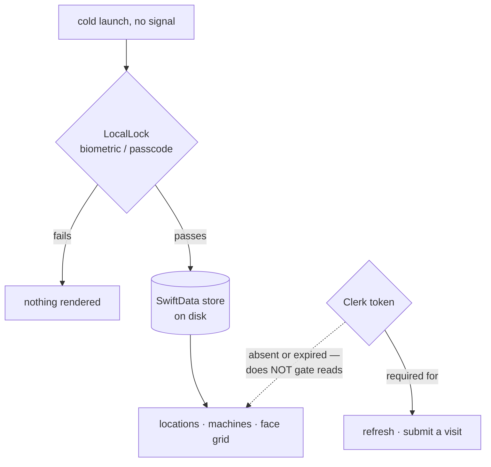
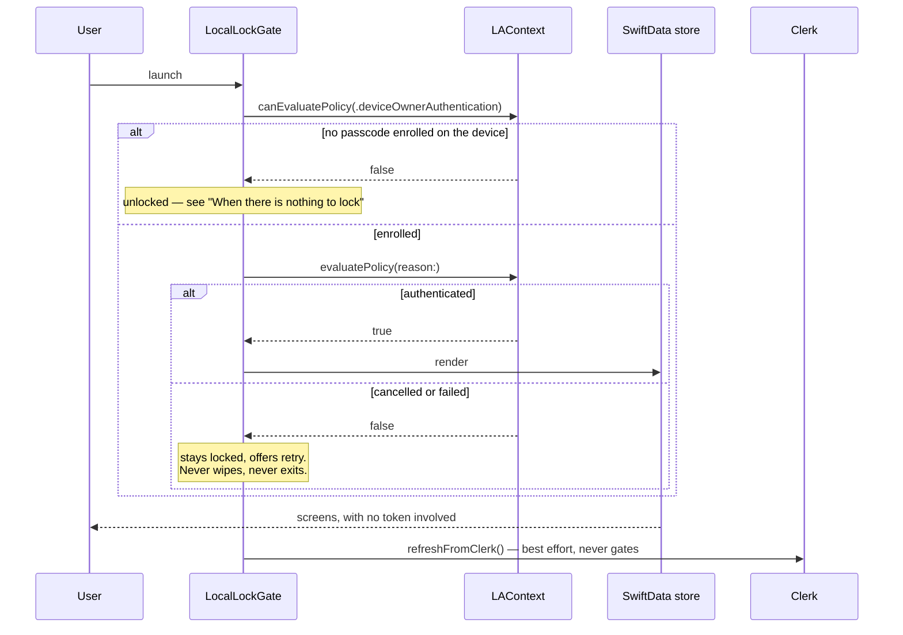
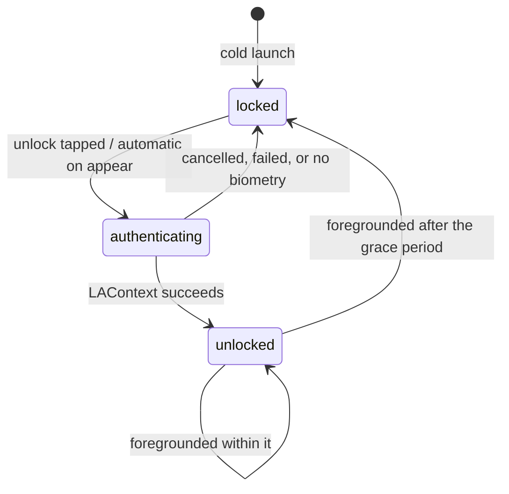
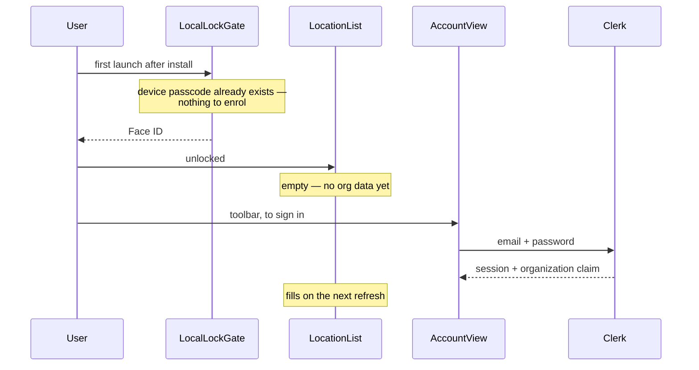

# Auth gates

Three things can stand between the operator and the data, and they guard
different assets. Confusing them produces either a phone that shows a stranger
the whole org, or an app that is useless in a basement.

| Gate | Protects | Needs network | May hide the store |
|---|---|---|---|
| `LocalLock` | the device being in the wrong hands | no | **yes — that is its job** |
| Clerk session token | the server's data | yes | **never** |
| Update wall | the server from an incompatible build | no (once told) | **never** |

## Why the store is readable without signing in

`Clerk.load()` is *expected* to fail on a cold offline launch. Gating the UI on
it would hide the planogram from someone standing at the machine, so the token
gates the network edge and nothing else.

That openness is what makes a local gate necessary: the store holds an entire
org's locations, machines, products and prices, sitting on disk with no
server-side check in front of it.

## Launch

`LAContext` is entirely local, so the gate works with no signal. That is the
whole reason the app gate is biometric rather than a sign-in.

## The lock's states

**A grace period, not an instant re-lock.** Servicing a machine means leaving
the app constantly — a camera, a phone call, the drive to the next location.
Re-prompting on every return is how people turn the feature off, and a disabled
lock protects nothing.

The window is **an hour**, roughly once per shift, chosen deliberately toward
convenience: the realistic threat here is a misplaced phone rather than a
targeted theft. It is a named constant precisely because it is a policy choice
— shorten it if that ever feels loose.

## First launch

**There is no local code to set up.** `LocalLock` evaluates
`.deviceOwnerAuthentication`, which reuses the phone's existing Face ID and
passcode. No app PIN is created, stored, or recoverable — so there is no
enrolment step, no reset flow, and nothing for an operator to forget. The
trade is that anyone who knows the phone's passcode is already past this gate;
for a crew of two that is the right side of the trade.

The order is also the reverse of the obvious guess: **the lock comes first,
before Clerk.** Signing in is not a gate, so it cannot be a step in a sequence
— it is a thing you go and do when you want the device to sync.

### Two gaps this exposes

Both are real today, neither is fixed by the lock itself.

**The lock asks before there is anything to protect.** On a fresh install the
store is empty, so the first thing a new operator meets is a Face ID prompt
guarding nothing, before they have any idea what the app is. The gate should
engage once the store has content; an empty store needs no gate and a prompt
without context teaches people to distrust the one that matters later.

**Nothing points a new operator at sign-in.** The empty state currently reads
"The store is empty. Re-run exportIosFixture.ts" — developer scaffolding — and
the only route to signing in is noticing the account icon in the toolbar. A
first run should say what is missing and offer the way to fix it.

Neither is a security hole. Both are the difference between a flow that
explains itself and one that is merely correct.

## When there is nothing to lock

If the device has no passcode enrolled, `canEvaluatePolicy` returns false and
the gate **opens** rather than sealing shut.

The alternative is worse in both directions: the operator is locked out of
their own field data, and the data being "protected" is already reachable by
anyone who picks the phone up, because the device itself has no lock. A gate
that only stops the legitimate user is not a security control.

Same shape as the update wall refusing to wall on a verdict it cannot
interpret — when the check itself is unavailable, failing closed harms only
the person doing their job.

## What the gate must not do

- **Never clear the store.** A failed unlock is not a sign-out; the data is
  still the operator's and still needed once they retry.
- **Never exit the app.** An app that kills itself cannot explain why.
- **Never gate on the network.** Reaching Clerk to decide whether to show a
  local screen reintroduces exactly the dependency the mirror exists to remove.
