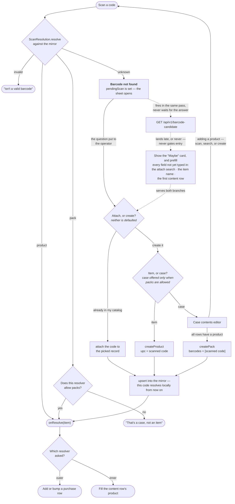

# Log Purchase — scanning a case's contents

Followed from the resolver's point of view: the same scan → attach-or-create
tree runs twice, once for a purchase row and once for a row of a case's
contents, and every path ends with a real `productId`.

> **Status.** Proposed, not built. Today the case-contents editor
> (`BarcodeNotFoundSheet.swift:305`) offers a flat `Picker` over every active
> product plus hand-typed name / category / bag barcode, and the inline
> products aren't created until `createPack` runs. This design replaces that
> row with scan-or-search and creates each product as it is resolved.

Code: [`BarcodeNotFoundSheet`](../../ios/Vendpire/Features/PurchaseLog/BarcodeNotFoundSheet.swift)
· [`PurchaseLogModel`](../../ios/Vendpire/Features/PurchaseLog/PurchaseLogModel.swift)
· [`ScanResolution`](../../ios/Vendpire/Domain/ScanResolution.swift)
· the web precedent: [barcode-resolution.md](barcode-resolution.md)

## Who owns what

```
PurchaseLogView
└── PurchaseLogModel
    ├── rows: [PurchaseRow]
    ├── MirrorCatalog ◄──────── one memoized read, shared; any create
    │                           invalidates it for everyone at once
    └── BarcodeResolutionModel(allowsPacks: true)
        │     onResolve → addOrIncrementRow(item)
        ├── pendingScan · candidateFetch · errorMessage · errorStatusCode
        ├── attach / createUnit / createPack
        └── contents: [PackContentDraft]   ← hoisted out of the view
            └── BarcodeResolutionModel(allowsPacks: false)
                  onResolve → contents[rowId].productId = item.recordId
                ├── its OWN pendingScan + candidateFetch
                └── attach / createUnit    ← no createPack: depth bounded here
```

Two instances, so two independent pending slots and two independent in-flight
candidate fetches — with no stack and no depth guard. The inner resolver simply
has no case branch to recurse through.

## The tree, run in both contexts



The edge from the contents editor back up to **Scan** is the whole feature: an
inner scan re-enters the *same* tree, one level down, with packs switched off.

## When the candidate lookup happens

Unconditionally, the instant a code comes back `unknown` — not when the operator
picks "create it". `handleScan` parks the code and fires `fetchCandidate` in the
same pass, which is also the pass that presents the sheet, so the answer always
lands *after* the sheet is already on screen.

It is not a create-only prefill. One candidate seeds three fields: the **attach**
search query, the item name, and the first content row. Serving the attach branch
is the point — typing the candidate's name into the search box is how an operator
discovers the thing already exists under a slightly different name, and that is
the branch that prevents duplicates. Deferring the lookup until "create it" would
answer only after the duplicate had already been made.

Three rules keep a suggestion from ever becoming an obstacle:

- **It never gates.** A failed or offline lookup leaves `candidate` nil; the
  sheet opens with no Maybe card and entry proceeds.
- **It never overwrites.** Prefill only touches fields with no keystrokes in
  them — that is what the `*Touched` flags are for.
- **It never lands on the wrong code.** `fetchCandidate` re-checks
  `pendingScan?.gtin14` before writing, so a slow answer to a code you have
  since rescanned is dropped.

The inner resolver follows the same rule for bag codes, which means an inner scan
fires its own lookup against its own pending slot — one more GET, and the reason
each resolver needs a candidate slot of its own rather than sharing one.

## What differs between the two resolvers

Only two things, and both fall out of `allowsPacks`:

| | outer (purchase row) | inner (case content) |
|---|---|---|
| a pack hit | adds a pack row | refused — "That's a case, not an item" |
| create offers | Item or Case | Item only |
| outcome | add or bump a purchase row | fill the content row's `productId` |

Everything else — the candidate lookup and its "Maybe" card, attach-before-create
as explicit peers, the 409 → *use existing instead* recovery, upsert-on-success
— is one implementation, reached by both.

## Why create-immediately

A content row resolved by **attach** already holds a real `productId`, because
attaching is a server mutation. Making **create** eager too means every row is
uniform: `PackContentDraft` is `{ productId, unitsText }`, and `prepare` loses
its entire second mode — no more carrying name / category / bagCode on a row
that may or may not become a product.

It also keeps the Phase 9 spec's rule intact everywhere: *every successful
attach or create upserts into the mirror immediately*, so the code resolves
locally from then on and the new product is usable in the same draft.

The cost is honest: abandoning the case form now leaves created products behind,
where today it creates nothing. That matches the stance `createPack` already
takes on partial failure — those are records the operator wanted, and a rerun
picks them out of the mirror instead of duplicating them.

## The UX surfaces

> **Status.** Proposed, not built. A companion to the tree above: where the
> tree fixes *what* each resolver decides, this fixes *where on screen* that
> decision happens.

| Surface | Kind | Appears when |
|---|---|---|
| Purchase Log | screen, root | always |
| Case Contents | screen, pushed | a case row is tapped |
| Resolution sheet | sheet, fixed-large detent | either resolver hits `notFound` |

One sheet component serves both resolvers. `allowsPacks` doesn't just change
which branches it offers — it changes how deep it can go.

**The sheet has its own push navigation**, not a single scrolling form. Its
root page holds the Maybe card and the attach-or-create choice; picking either
pushes to a dedicated page with a back chevron, same mechanics as a
`NavigationStack`, just scoped to the sheet:

```
root → Attach                              (1 push)
root → Create → Item                       (outer: 2 pushes)
root → Create → Case                       (outer: 1 push, commits immediately)
root → Create                              (inner: 1 push — no item/case fork)
```

Picking "Case" on the kind page commits on the spot — no further push, no name
field. Everything else that reaches a name field pushes one level deeper than
that.

**A case appears in the Purchase Log before its contents do.** Committing
"Case" doesn't open Case Contents — it closes the sheet and drops a row into
the purchase list immediately, flagged with an amber **Add contents** badge
(distinct from the red-orange **New** badge used elsewhere for a just-created
product, so "needs attention" never reads as "informational"). That row stays
tappable forever, filled or not, so a case can be revisited and edited later.
Tapping it — now or on a later pass — is what pushes Case Contents.

This is what makes the abandonment cost in the section above a non-issue in
practice: a half-filled case is never silent data loss, it's a row sitting in
the list with a badge on it, exactly as discoverable as any other unfinished
work.

**Two independent steppers per case.** The purchase row's stepper counts how
many of that case were bought; each content row's stepper, one level down in
Case Contents, counts units of that product *inside one case*. Same control
both places — a stepper with the number tappable to type an exact value
instead of tapping `+` repeatedly.

**Still open:**
- A case has no name until it has contents — "New case" is a placeholder, not
  a decision. The tree never asks for one.
- Save-time validation when a case is still empty — block the save, or warn
  and allow saving anyway — is unresolved.

## The two codes, still two codes

The warning from [barcode-resolution.md](barcode-resolution.md) holds and gets
sharper, because now both codes can be scanned:

- the **case** code → `pack.barcodes[]`, owned by the outer resolver
- the **bag** code → `product.upc`, owned by the inner one

A code can be owned only once; `ProductServiceImpl.validate` rejects a `upc`
already on another product *or* used as a pack's case barcode. So scanning the
case box a second time while filling in its contents is caught twice over — by
the inner resolver refusing a pack hit, and by the server refusing the code.
