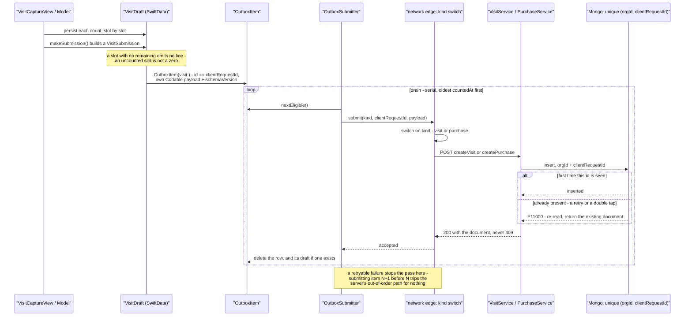

# Visit capture — from a tap to a Mongo document

Followed from one count's point of view: a number typed into a cell on the
face grid, carried offline for as long as it takes, and landing exactly once.

> **Status: built.** Phase 8 shipped the capture screen and the outbox; Phase
> 9 added purchase logging on the same pipe. Everything below is shipped code,
> not a plan.

Code: [`VisitCaptureModel`](../../ios/Vendpire/Features/VisitCapture/VisitCaptureModel.swift)
· [`VisitDraft`](../../ios/Vendpire/Store/Model/VisitDraft.swift)
· [`OutboxItem`](../../ios/Vendpire/Store/Model/OutboxItem.swift)
· [`OutboxSubmitter`](../../ios/Vendpire/Services/Outbox/OutboxSubmitter.swift)
· [`SubmitOutcome`](../../ios/Vendpire/Services/Outbox/SubmitOutcome.swift)
· [`VendpireAPIClient+Outbox`](../../ios/Vendpire/Services/VendpireAPI/VendpireAPIClient+Outbox.swift)
· [`Visit.ts`](../../packages/platform/src/data-access/models/Visit.ts)
· [`Purchase.ts`](../../packages/platform/src/data-access/models/Purchase.ts)

## Failure classification

What the server's answer means for a queued row — the whole reason the
outbox can be left alone in a basement with no signal.

| Response | Treatment |
|---|---|
| Network / timeout / 5xx / 429 | retryable; exponential backoff + jitter, cap ~1h, infinite |
| 401 | every request stamps a fresh Clerk token, so this is a real lapsed session - scheduled for retry like any other failure, never dropped |
| 403 (no org) | retryable; surfaces as "you're not in an organization" |
| 400 / 404 | permanent → `needsAttention`, shown with the server's own message, verbatim |
| idempotent 200 returning an existing document | success |

## The two invariants

**A row leaves the queue on success, and no other way.** `OutboxSubmitter`
only ever deletes a row from its `accepted` branch. Every other outcome -
retryable, unauthorized, no-organization, blocked-by-update-floor, or
permanent - writes a new `status` and schedules or waits, but the row stays
on disk. A force-quit mid-submit leaves a row reading `sending` that the next
drain reclaims back to `queued` before doing anything else, which is what
makes a second concurrent drain the only way to double-submit - and
idempotency on the server absorbs even that.

**Never silently delete a draft.** The counts a person walked a route to
collect exist in exactly one place until the server has them. A permanent
failure parks the row in `needsAttention` with the server's own words instead
of discarding anything, and the draft beside it survives too - deleting it
is always an explicit, visible act, never a side effect of a failed submit.

## Purchases ride the same pipe

A purchase is a second producer into the same queue, not a second queue.
`OutboxItem(purchase:)` sets `kind: "purchase"`, keys the row on the
purchase's own `clientRequestId`, and that's the only new code at the
network edge - a `kind` switch in `VendpireAPIClient+Outbox.swift` that
decodes the payload and calls `createPurchase` instead of `createVisit`,
mapped through this same failure table.

There is no draft entity behind a purchase. `PurchaseLogModel` holds the
in-progress lines in memory; Save encodes them straight into the
`OutboxItem`'s payload, so the payload *is* the persisted state. That is why
`OutboxSubmitter.deleteWithDraft` looks up a `VisitDraft` by id and finds
none for a purchase row - it is a no-op, not a bug, and it is also why a
stuck purchase has no draft to go back and fix (see
[`stuck-outbox.md`](../runbooks/stuck-outbox.md)).

## Related

| File | Shows |
|---|---|
| [`visit-sync.md`](visit-sync.md) | The mirror's downward pipe, and the outbox's upward pipe in more depth |
| [`../runbooks/stuck-outbox.md`](../runbooks/stuck-outbox.md) | What an operator does when a row stops moving |
