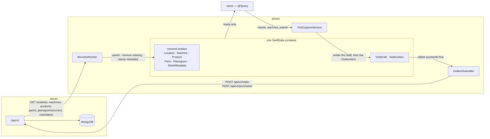
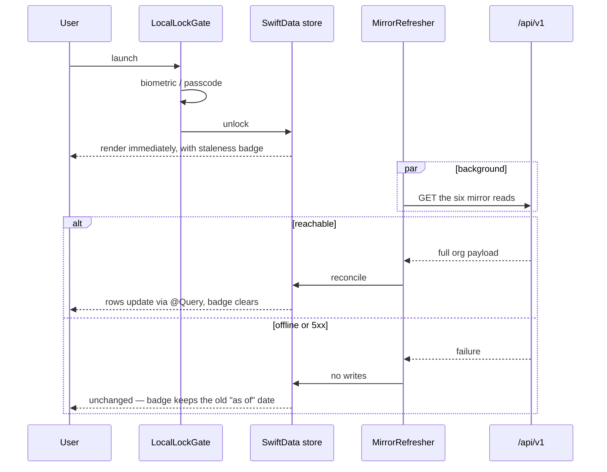
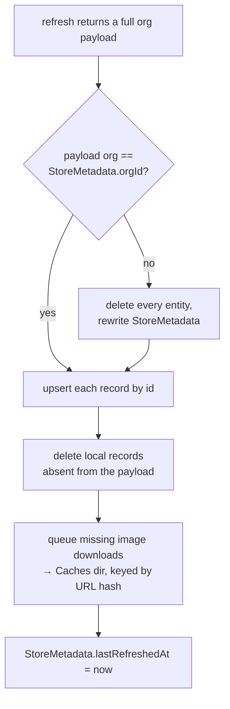
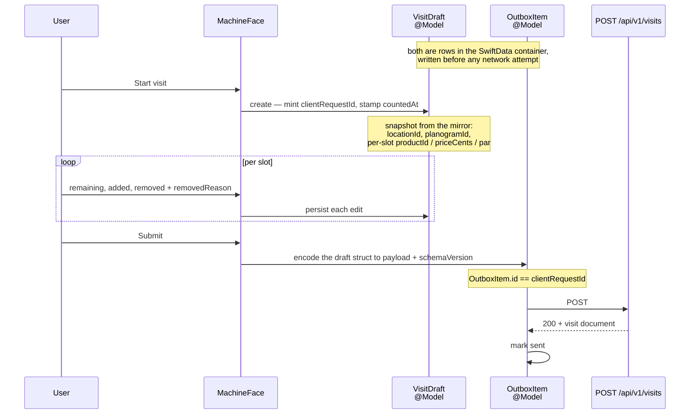
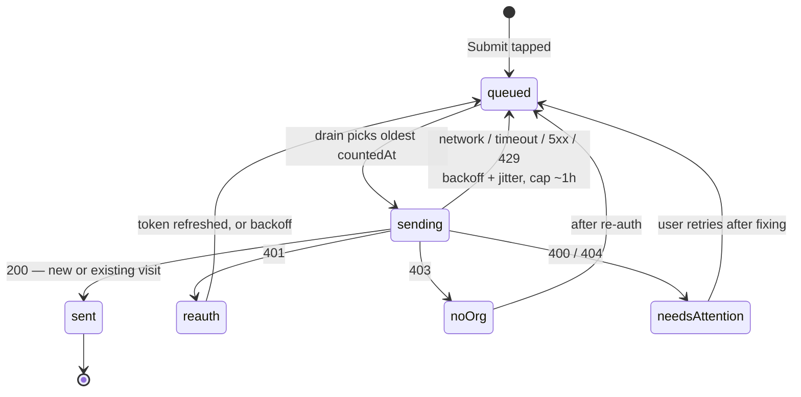
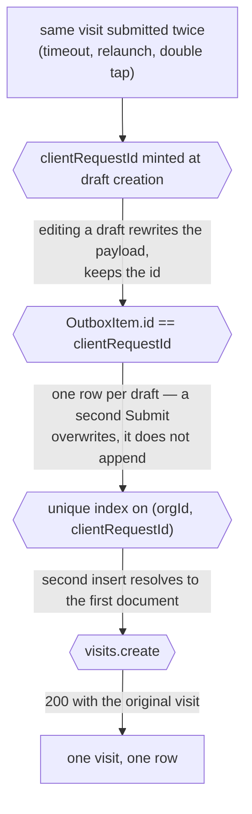

# Visit sync — the mirror and the outbox

How the phone's store fills from the server, and how a visit captured in the
field gets back. Two one-way pipes; there is no merge step anywhere.

**Status: designed, not built.** `VendpireAPI` is an empty protocol today.
The downward half lands in Phase 7, the upward half in Phase 8, and the
`/api/v1` routes they call land in Phase 6. Plan of record:
`docs/plans/2026-10-05-visits-and-ios.md`.

## The two pipes

Reference data moves down and is never edited on the phone. Observations move
up and are never edited on the server. No entity travels both ways.

Views never write to the store and never touch the network — see
`ios/ARCHITECTURE.md`.

**Pending work is stored, not held.** `VisitDraft` and `OutboxItem` are
SwiftData `@Model`s in the same container as the mirrored entities, so a
force-quit with drafts queued loses nothing. Nothing about a pending submit
lives only in memory.

## Downward — cold launch and refresh

The store renders before the network is consulted, and a failed refresh leaves
the previous contents on screen.

Auth is not consulted on this path until the request itself. `Clerk.load()`
failing on a cold offline launch does not gate the store.

## Downward — what reconcile does

A refresh replaces org state wholesale. There is no cursor and no per-record
merge.

Entity models carry no `orgId` and no query filters by org — the single
`StoreMetadata` row is the only place the org is recorded.

## Upward — a visit's life

`clientRequestId` is minted once, at **Start visit**, and survives every edit.

**Corrected 2026-10-24.** This previously said the payload is frozen as bytes
and never re-encoded. The draft is stored as a struct and encoded at submit:
`Remote+Generated.swift` is the only file that knows the generated types, so a
spec change is a compile error there rather than a silent re-encode. Frozen
bytes also made a stuck draft unfixable and were silently wrong under a
semantic change. `schemaVersion` is kept for migration, not for freezing. See
`docs/superpowers/specs/2026-10-24-visit-outbox-design.md`.

## Upward — outbox states

The drain is serial, oldest `countedAt` first, and stops at the first retryable
failure.

No edge leads out of the machine except `sent`. A draft is never dropped.

### Response routing

| Response | Treatment |
|---|---|
| Network / timeout / 5xx / 429 | retryable; exponential backoff + jitter, cap ~1h, infinite |
| 401 | re-auth once, then back off. Never drop the draft |
| 403 — no org | retryable after re-auth; surface "you're not in an organization" |
| 400 / 404 | permanent → `needsAttention`, listed with the server's message |
| 200 returning an existing visit | success |

## Why a resubmit is harmless

Four layers absorb a duplicate, and the server's answer to one is a 200 with the
original document — never a 409.

## Server-side rules the outbox depends on

| Rule | Failure if broken |
|---|---|
| Idempotent create returns 200 with the original document, never 409 | The outbox cannot tell "succeeded, response lost" from "failed" — it drops the draft or retries forever |
| Out-of-order / backdated visits are accepted, logged, never rejected | Real field data is destroyed; backdating is normal offline |
| Reference validation ignores `deletedAt` | A soft-deleted product 400s a queued draft permanently and the day's counts are lost |
| Nothing derived is persisted — sold, revenue, COGS and profit compute at read time | A late visit would need a recompute job instead of simply changing what the next read returns |

## Related

| File | Shows |
|---|---|
| `visit-calculations.md` | What the server computes from the visits this pipe delivers |
| `forced-update.md` | `ClientSupportMiddleware` at the same `VendpireAPI` seam |
| `../runbooks/stuck-outbox.md` | Operator recovery (Phase 9) |
