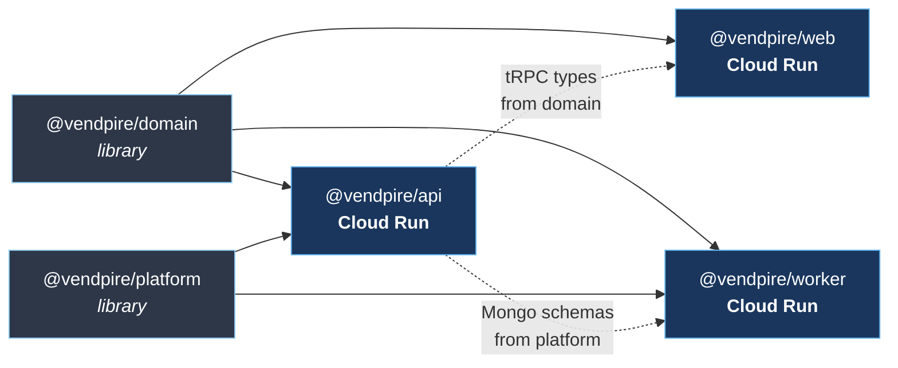
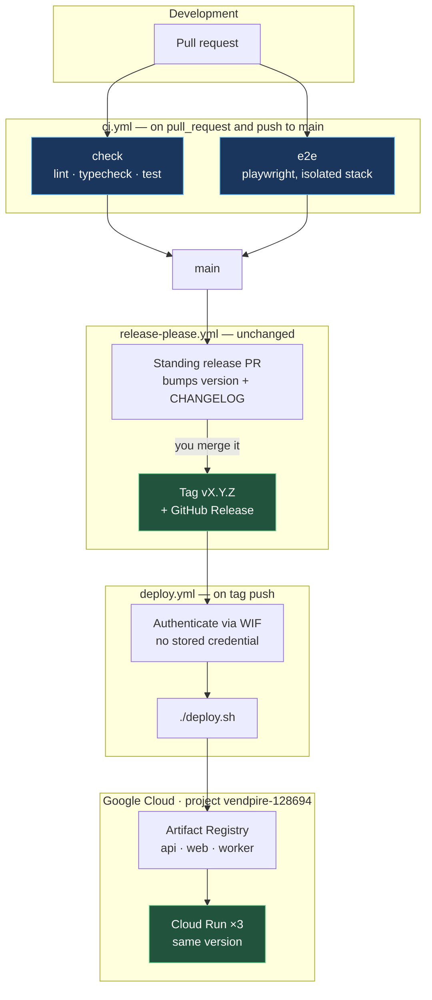
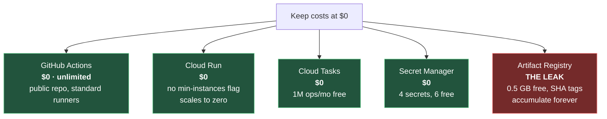
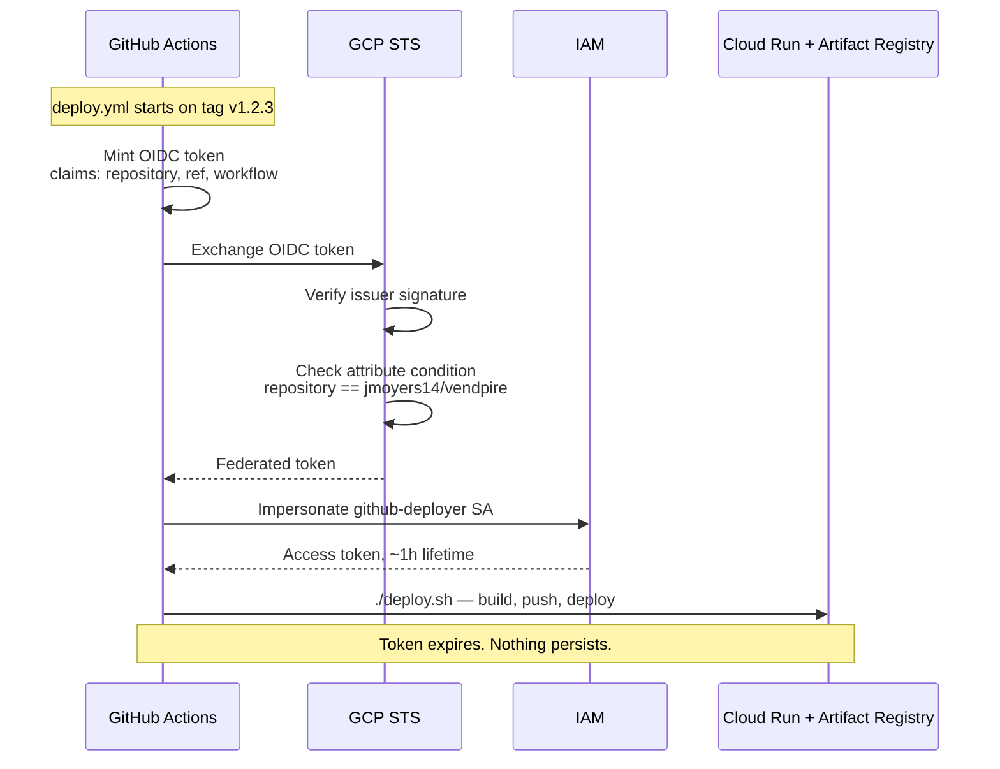
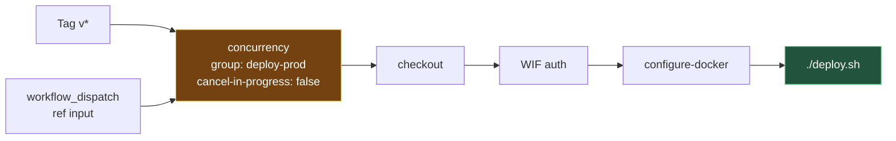
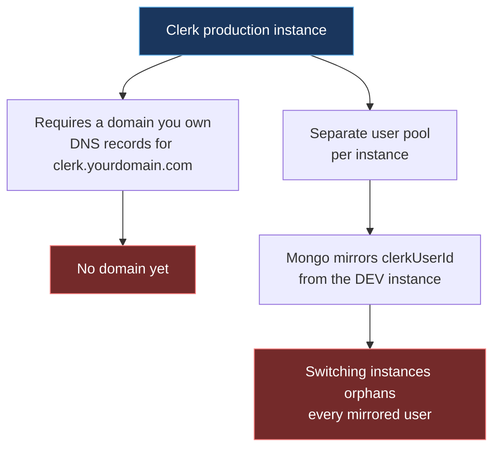

# CI/CD and Release Strategy

**Date:** 2026-10-06
**Status:** Implemented 2026-10-07. Targets staging — see Environments.
iOS CI deferred — see Follow-up.

## Context

The repo has a release mechanism and a deploy mechanism, and nothing connects
them. `release-please` maintains a version and will cut tags; `deploy.sh`
builds and ships three Cloud Run services. But the tag triggers nothing, and
the deploy runs on one laptop with local Docker and secrets read out of local
`.env` files. Most importantly, **nothing runs tests before code reaches
`main`** — `.github/workflows/` contains only `release-please.yml`.

This spec closes those gaps: CI on every pull request, and a deploy that fires
automatically from the release tag with no long-lived credential anywhere.

### The question that prompted this

> "If I have a release that's only in the API, do I build, release and deploy
> every package?"

Two independent questions hide in that one:

1. **Versioning granularity** — one version for the repo, or one per package?
2. **Deploy granularity** — ship all services, or only the changed one?

**Decision: one version, deploy everything.** The reasoning is in the next
section, because it is the load-bearing decision in this document.

---

## Why deploy everything

### The dependency graph makes "API-only" a fiction



`web` imports `@vendpire/domain` for its tRPC types. `api` and `worker` share
Mongo schemas through `@vendpire/platform`. A one-line edit in `domain` fans
out to all three services.

Determining that a change is *truly* API-only requires real dependency-graph
analysis. What people actually write is path globs — and path globs are how you
ship a stale `web` bundle against a changed tRPC contract.

### Skew is the expensive failure, not build minutes

If `api` is at v1.4 and `web` is at v1.1, you now own an API compatibility
window: every procedure change must stay backward-compatible until `web` catches
up. Large orgs pay that tax because independent deploy cadence is worth it to
them. A solo project has no such need.

### One version makes production debuggable

`system.version` and the app footer already exist. "Prod is v1.4.2" is one fact.
Per-service versions turn every incident into *which version of which service,
and is that combination one we have ever tested together?*

### The cost is near zero

Three sequential Docker builds add roughly three minutes. GitHub's Ubuntu
runners are native amd64, so `docker build --platform linux/amd64` stops being
QEMU-emulated — CI builds will likely be **faster** than on an ARM Mac. A no-op
redeploy of `web` is a Cloud Run container swap: seconds, no downtime.

`release-please-config.json` already declares exactly one package (`"."`), so
the repo-wide version is already correct. No change needed there.

---

## Architecture



The only human decision point is **merging the release PR**. Everything either
side of it is automatic.

---

## The headline finding: `deploy.sh` is already nearly CI-ready

Whoever wrote it was thinking about this. Line 5:

> *"Never let gcloud stop on an interactive prompt — in a background/CI shell a
> prompt hangs forever."*

And every secret read is **env-first**, with the `.env` file as a *fallback*:

```bash
CLERK_PUBLISHABLE_KEY="${VITE_CLERK_PUBLISHABLE_KEY:-$(grep ... packages/web/.env.local ...)}"
```

Set the env var in CI and the `.env` read never evaluates. Combined with the
fact that all four Secret Manager secrets already exist — so `ensure_secret`
only re-grants an idempotent IAM binding and never reads a local file — **the
single genuine blocker is the gcloud-configuration safety guard** at lines 48–60.

### The one change

```bash
if [ -n "${CI:-}" ]; then
  # In CI the identity comes from Workload Identity Federation, not a local
  # gcloud configuration. Pin the project explicitly; the account check is
  # meaningless here because the caller is a service account by construction.
  gcloud config set project "$PROJECT" --quiet >/dev/null
else
  gcloud config configurations activate "$CONFIG" >/dev/null
  # ...existing account/project match check, unchanged...
fi
```

The laptop path stays byte-identical. The mis-deploy guard protecting against
hitting a work project still runs locally, which is the only place that risk
exists.

### What already works unchanged

| Step | Why it survives CI |
|---|---|
| `CLOUDSDK_CORE_DISABLE_PROMPTS=1` | Already set, explicitly for this reason |
| `gcloud auth configure-docker` | Works after `google-github-actions/auth` |
| `GIT_SHA` via `git rev-parse --short HEAD` | Works at `actions/checkout` depth 1 |
| The `-dirty` suffix check | CI tree is always clean, so never fires |
| `APP_VERSION` from root `package.json` | release-please bumped it in the tagged tree |
| `docker build --platform linux/amd64` | Native on Ubuntu runners — faster than local |
| `ensure_secret` × 4 | Secrets exist; only the IAM binding re-runs |
| The `WORKER_URL` placeholder correction | Services exist, so the branch never triggers |

---

## Cost: where the money actually is

The repo is **public**, which resolves the GitHub Actions question entirely.



**GitHub Actions is free and unlimited** for public repositories on standard
runners. There is no minute budget to ration, so e2e runs on every PR with no
reservation. (For context, had the repo been private, the Free plan's 2,000
minutes/month would still have allowed roughly 130 PRs — and exceeding it
*halts* Actions rather than billing you, since the default spending limit is $0.
Either way there was no cost risk here.)

**Cloud Run is free** because `deploy.sh` passes no `--min-instances`, so it
defaults to 0 and all three services scale to zero when idle. The free tier is
2M requests, 360k GiB-seconds, and 180k vCPU-seconds per month.

**Artifact Registry is the real leak, and it is not currently handled.** Every
deploy pushes three images tagged both `:latest` and `:<git-sha>`. The SHA tags
keep old layers alive forever, and the free tier is only 0.5 GB. A handful of
deploys crosses it. Overage is cheap — about $0.10/GB/month — but "cheap" is not
"$0", and it grows monotonically.

**Fix:** attach a cleanup policy to the Artifact Registry repo, keeping the most
recent N versions per image and deleting older ones. This goes in
`scripts/setup-ci-auth.sh` as part of one-time setup, since it is the same
run-once-as-owner category of work.

Rollback still works after cleanup: Cloud Run retains *revisions* independently
of whether the image tag still exists, and keeping the last 10 versions covers
any realistic rollback window.

---

## Authentication: Workload Identity Federation

No long-lived credential is stored anywhere. GitHub mints a short-lived OIDC
token; GCP trades it for scoped, temporary credentials.



The provider carries an attribute condition pinning it to
`assertion.repository == 'jmoyers14/vendpire'`. Even if the provider
configuration leaked — and it is not secret — no other repository can mint
credentials against it.

### The role set, and an honest caveat

`deploy.sh` does not merely deploy. It enables APIs, creates Cloud Tasks queues,
creates the `cloud-tasks-invoker` service account, and binds roles to it. So the
deployer needs:

| Role | What in `deploy.sh` needs it |
|---|---|
| `run.admin` | `gcloud run deploy` / `services update` |
| `artifactregistry.writer` | `docker push`, repo create |
| `secretmanager.admin` | `add-iam-policy-binding` on the four secrets |
| `cloudtasks.admin` | Creating the three queues |
| `iam.serviceAccountAdmin` | Creating `cloud-tasks-invoker` + binding to it |
| `iam.serviceAccountUser` | Deploying as the runtime service account |
| `serviceusage.serviceUsageAdmin` | `gcloud services enable` |

That is close to project-admin, scoped to this one project. The alternative —
splitting bootstrap out so CI needs only `run.admin` + `artifactregistry.writer`
— reintroduces exactly the two-divergent-code-paths problem this design chose to
avoid.

**Decision: grant the broad set, document each role, accept it.** Single-purpose
personal project, blast radius of one project, and no key exists to steal.

---

## Workflows

### `ci.yml` — on `pull_request` and `push` to `main`

Two parallel jobs:

- **`check`** — `bun install --frozen-lockfile`, then `lint`, `typecheck`, `test`
- **`e2e`** — adds `playwright install --with-deps chromium`, then `test:e2e`,
  uploading the HTML report as an artifact on failure

Both become required status checks on `main`. That is a GitHub branch-protection
setting applied in the web UI; it cannot be committed to the repo.

#### Public-repo security requirements

A public repo means anyone can open a pull request, so:

- **Use `pull_request`, never `pull_request_target`.** The latter runs fork code
  with access to secrets — the canonical exfiltration footgun.
- **Fork PRs receive no secrets.** This is GitHub's default and we rely on it.
- Enable *"Require approval for all external contributors"* in Actions settings.

The e2e suite degrades gracefully here, by existing design:
`packages/e2e/global-setup.ts` returns early without Clerk keys, and
`fixtures.ts:206` skips browser specs. So a fork PR still gets full
lint/typecheck/test plus the api-only e2e specs — it just cannot run
sign-in flows. That is the correct outcome and needs no special handling.

#### Two e2e adjustments

- `playwright.config.ts` sets `fullyParallel: true`, and each worker boots its
  own in-memory Mongo plus `api` plus `web`. That is tuned for a many-core Mac
  and will thrash a 2-core runner. Set `workers: process.env.CI ? 2 : undefined`.
- `mongodb-memory-server` downloads a Mongo binary on first run. Cache it, or
  every run pays the download.

### `release-please.yml` — unchanged

Already correct. The comments explaining why `separate-pull-requests: true` is
load-bearing are worth preserving verbatim.

Note: `git tag` is currently empty, so release-please has never cut a tag in
this repo. The first run exercises that path for real.

### `deploy.yml` — on `push: tags: ['v*']` plus `workflow_dispatch`



`concurrency` matters: two simultaneous deploys race on Cloud Run revisions and
on the `WORKER_URL` correction step. `cancel-in-progress: false` is deliberate —
a half-cancelled deploy is worse than a queued one.

The `workflow_dispatch` `ref` input lets you re-deploy or roll forward to any
tag by hand, preserving `deploy.sh`'s current on-demand feel.

---

## GitHub secrets

| Name | Needed by | Actually sensitive? |
|---|---|---|
| `VITE_CLERK_PUBLISHABLE_KEY` | deploy — hard-fails without it | No, `pk_` is public |
| `POSTHOG_API_KEY`, `POSTHOG_HOST` | deploy — server analytics | No, write-only ingestion |
| `VITE_POSTHOG_KEY`, `VITE_POSTHOG_HOST` | deploy — browser analytics | No |
| `CLERK_PUBLISHABLE_KEY`, `CLERK_SECRET_KEY` | e2e, Clerk **dev** instance | Yes — dev only |
| `E2E_CLERK_USER_EMAIL`, `E2E_CLERK_USER_PASSWORD` | e2e test user | Yes — dev only |

**No production secrets enter GitHub.** The Atlas URI, the production Clerk
`sk_`, and the webhook signing secret stay in Secret Manager, untouched by this
work.

### The PostHog trap

The PostHog keys are *optional* in `deploy.sh`: omit them and it ships without
analytics, printing a line nobody reads. Laptop deploys supply them from `.env`;
CI would not. **Set them, or analytics silently disappears the moment deploys
move to CI.** This is the most likely way this migration quietly regresses.

---

## Rollback

Not documented anywhere today, which is a problem given when you will need it.
Cloud Run retains revisions, so rollback is traffic-shifting, not rebuilding:

```sh
gcloud run revisions list --service vendpire-api --region us-central1
gcloud run services update-traffic vendpire-api \
  --to-revisions=<prior-revision>=100 --region us-central1
```

Because all three services ship as one version, **roll back all three
together** — that is the direct consequence of the one-version decision, and the
runbook must say so explicitly. Add to `DEPLOY.md`.

---

## Deliverables

| File | Change |
|---|---|
| `.github/workflows/ci.yml` | New — `check` + `e2e` jobs |
| `.github/workflows/deploy.yml` | New — tag-triggered, WIF auth, runs `deploy.sh` |
| `deploy.sh` | One `if [ -n "${CI:-}" ]` branch around the guard |
| `scripts/setup-ci-auth.sh` | New — WIF pool/provider/SA + AR cleanup policy |
| `packages/e2e/playwright.config.ts` | `workers: process.env.CI ? 2 : undefined` |
| `DEPLOY.md` | CI deploy path, secrets table, rollback procedure |
| `.github/workflows/release-please.yml` | Unchanged |

### Manual steps, documented in `DEPLOY.md`

1. Run `scripts/setup-ci-auth.sh` once locally as project owner.
2. Add the GitHub secrets above.
3. Enable branch protection on `main`, requiring `check` and `e2e`.
4. Enable *"Require approval for all external contributors"*.

## Verification

1. Open a throwaway PR with a deliberate type error — `check` must fail.
2. Fix it; `check` and `e2e` must both pass.
3. Merge to `main`; confirm release-please opens a release PR.
4. Merge the release PR; confirm a `v*` tag appears **and** that the merged PR's
   label moves to `autorelease: tagged`. If it stays `autorelease: pending`, use
   the manual recovery in `release-please.yml`'s header comment.
5. Confirm `deploy.yml` triggers, authenticates with no stored key, and all three
   services report the new version at `<api-url>/system.version` and in the
   footer. A version mismatch between them means a half-landed deploy.
6. `curl -X POST <worker-url>/tasks/syncUser -d "{}"` must still return **403**,
   proving the OIDC guard survived.
7. Practice one rollback on `vendpire-web` and confirm the footer version reverts.

## Environments

**There is one environment, and it is staging.** This was decided after the rest
of the spec, when it turned out the deployed stack was serving Clerk
*development* keys.

### What was wrong

`deploy.sh` set `ENVIRONMENT=production`, but the stack it deployed was running
`pk_test_` / `sk_test_` against `dynamic-kit-6657.clerk.accounts.dev` — verified
by pulling the deployed bundle:

```sh
curl -s https://vendpire-web-…run.app/assets/index-….js | grep -oE 'pk_(test|live)_.{8}'
# pk_test_ZHluYW1p
```

`ios/Config/Release.xcconfig` already admitted this in a comment: *"Still the dev
Clerk instance: there is no production Clerk instance yet."*

### Why this is not a key swap



1. **Clerk production instances require a domain.** Hard Clerk requirement — they
   need DNS records and cannot run against `*.run.app`. We do not own one yet, so
   production Clerk is blocked on buying a domain.
2. **Dev instances are deliberately permissive.** Relaxed origin checks (which is
   *why* `*.run.app` works today), bot protection effectively off, lower limits.
   Not suitable for real traffic.
3. **Users do not transfer between instances.** The Mongo mirror holds
   `clerkUserId` / `clerkOrgId` values minted by the dev instance. Pointing at a
   production instance orphans all of them. Free now while it is all test data;
   a migration after launch.

Point 3 is the argument for naming this correctly now rather than later.

### What changed

`deploy.sh` pins `DEPLOY_ENVIRONMENT="staging"` next to the other constants, and
both services read it. This is **labeling only** — every environment check in the
codebase is `=== "local"` or `!== "local"`
(`registerWebhookCore.ts`, `registerTaskQueue.ts`, `InlineTaskQueue.ts`), so
nothing distinguishes staging from production behaviorally. `Environment` in
`appConfig.ts` already included `"staging"`, so no type or schema change was
needed. The win is that `/system.version`, the app footer, logs, and PostHog
events stop claiming to be production.

`deploy.yml` targets the GitHub `staging` environment for the same reason.

### Deliberately not renamed

The Cloud Run services stay `vendpire-api` / `-web` / `-worker`. Renaming them to
`-staging` would mint new `*.run.app` URLs, which means re-pointing Clerk's
allowed origins and the Clerk webhook endpoint — real disruption for zero
functional gain. When a production stack exists it gets its own service names.

### A correction to the earlier cost reasoning

While choosing prod-only, staging+prod was described as "roughly doubling infra
cost." That is wrong and should not stand, because the cost constraint fed the
decision:

- Cloud Run passes no `--min-instances`, so a second service set scales to zero.
- Atlas M0 is one cluster, but a second *database* inside it is free.
- Clerk's free plan includes a development *and* a production instance.

Two environments is close to $0. The real cost is operational — two secret sets,
two Clerk instances, two webhook endpoints — not dollars. Prod-only remains the
right call for *simplicity*, but not for the reason originally given.

### Adding production later

Ordered, because each step blocks the next:

1. Buy a domain. This is the gate, and DNS plus Clerk domain verification is the
   slow part.
2. Create the Clerk production instance; add its DNS records.
3. Map the domain to Cloud Run for `web` and `api`.
4. New secret values: `sk_live_` for the api, the prod instance's `whsec_` for the
   worker, `pk_live_` baked into the web bundle.
5. Register the webhook endpoint on the production instance and re-subscribe the
   seven events listed in `DEPLOY.md`.
6. Swap `CLERK_PUBLISHABLE_KEY` in `ios/Config/Release.xcconfig` — currently the
   dev key, with a comment saying so.
7. Decide then whether staging survives. If it does, `deploy.sh` needs
   parameterizing by environment and `deploy.yml` needs a second target.

Accept that existing dev-instance users are orphaned, or recreate them.

## Follow-up: iOS CI

The `ios/` app landed on `main` after this spec was approved, so it is not
covered here. It has two real unit test targets — `SessionTokenClaimsTests` and
`StoreSchemaTests` — that nothing currently enforces.

Deferred rather than rushed because `ios/Scripts/xc` hard-pins
`DEVELOPER_DIR` to Xcode 26.1 and `VENDPIRE_SIM` to "iPhone 17 Pro", and
GitHub's `macos-latest` runners may ship neither. Both are overridable by env, so
this is tractable, but finding a working Xcode/simulator combination will take a
few CI round-trips and should not hold up the TypeScript pipeline.

Notes for when we pick it up:

- macOS runners are free for public repositories, so cost is not a constraint.
- `xc test` already passes `-skip-testing:VendpireUITests`, so the slow launch
  performance tests stay out of CI by default — the unit targets are the value.
- `biome.json` globs only TS/JS, so `ios/` needs no lint wiring.
- This would be a third job in `ci.yml` on `macos-latest`, not a new workflow.

## Explicitly out of scope

No production environment (blocked on a domain — see Environments), no
path-filtered selective deploys, no per-package versions, no PR preview
environments. Each is a real option if the project's shape changes. None earns
its complexity today.
