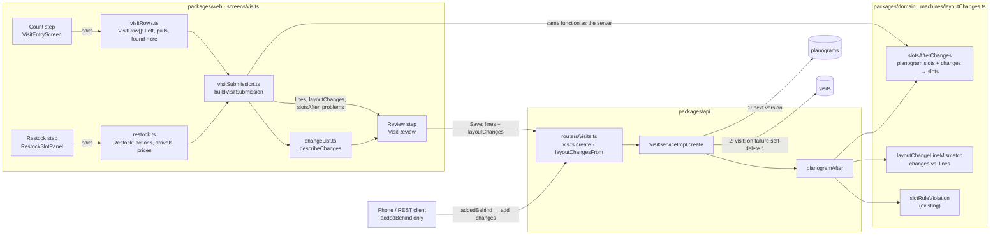

# Count and Restock visit entry (web) Implementation Plan

> **For agentic workers:** REQUIRED SUB-SKILL: Use superpowers:subagent-driven-development (recommended) or superpowers:executing-plans to implement this plan task-by-task. Steps use checkbox (`- [ ]`) syntax for tracking.

**Goal:** Enter a visit in Count and Restock (before photos, then after photos with four actions per product) plus a review, saving the visit lines and the next planogram version together.

**Architecture:** A pure `LayoutChange` model and `slotsAfterChanges` in `@vendpire/domain`, used by both the server (`planogramAfter`) and the web review. The web keeps Count rows as today (`visitRows.ts`), adds a pure Restock state module (`restock.ts`) and a pure builder that turns Count and Restock into lines + changes (`visitSubmission.ts`). `VisitEntryScreen` becomes a three-step screen.



The web and the server both call `slotsAfterChanges`, so the after face on the review is the planogram the server writes. The changes flow one way: Restock answers → `layoutChanges` → planogram. Nothing turns a layout back into changes.

**Tech Stack:** Bun, TypeScript, tRPC + zod, trpc-to-openapi, React + TanStack Query, Tailwind, `bun test`.

**Spec:** `docs/superpowers/specs/2026-11-09-visit-count-restock-web-design.md` (read it first; also `docs/diagrams/visit-layout-changes.md` for the verbs and Nov 5 cases).

## Global Constraints

- Naming follows `CLAUDE.md`: `build*` constructs in memory, `create` persists; no positional booleans; acronyms as words.
- Never `await` inside an expression that also spreads, destructures or indexes.
- A blank count is never saved as zero (`VisitRow.left === ""` → no line).
- Sold out is not removed: Added 0 keeps the product in the planogram.
- The app never links a move on its own; only the operator's Moved / Swapped / "Came from?" tap does.
- Every counted product that isn't in its slot after Restock gets `removed = remaining` with a reason.
- `addedBehind` stays accepted on `visits.create` (published in `openapi/vendpire.yaml`); the web sends only `layoutChanges`.
- `layoutChanges` is optional and defaulted, so the phone is unaffected. Its shapes are published; later changes must be additive.
- No changes to `packages/domain/src/visits` engine arithmetic, the planogram editor, iOS, or par (placeholder `10`).
- Kept from PR #46: planogram written first and soft-deleted if the visit insert fails; `CONFLICT` if the planogram changed since the form opened or `countedAt` isn't after its `effectiveFrom`; a visit with no changes saves at any date.
- Line prices: departing lines carry the slot's price before; staying and arriving lines carry the slot's price after (the engine prices the next interval from this line).

## Review Focus

1. **A Count edit after Restock answers exist** (Left blanked, or a Count pull added under a different reason): the answer must be flagged as a problem that blocks Save, not silently dropped or rewritten. Tested in Task 5.
2. **A move or + Add product into a slot that already holds that product**: must be a named problem before save, not a server 400 or a duplicate line. Tested in Tasks 1 and 5.
3. **Swapped with a mixed slot**: the operator picks which product in the other slot; both rows end up `moved` and linked. Tested in Task 4.
4. **An arrival with Added left blank**: a problem, never saved as `added = 0`. Tested in Task 5.
5. **A slot that was empty before and gets a product**: price must be entered (pre-filled from the source slot on a move); blank blocks save. Tested in Tasks 4 and 5.

---

### Task 1: Layout changes in the domain

**Files:**
- Create: `packages/domain/src/machines/layoutChanges.ts`
- Create: `packages/domain/src/machines/layoutChanges.test.ts`
- Modify: `packages/domain/src/index.ts` (export it)

**Interfaces:**
- Produces:
  ```ts
  export const PLACEHOLDER_PAR = 10;
  export type LayoutChange =
    | { kind: "move"; productId: string; fromSlotCode: string; toSlotCode: string }
    | { kind: "remove"; slotCode: string; productId: string }
    | { kind: "add"; slotCode: string; productId: string }
    | { kind: "set-price"; slotCode: string; priceCents: number };
  export interface LayoutSlot { slotCode: string; productId: string; par: number; priceCents: number }
  export type LayoutChangeViolation =
    | { kind: "product-not-in-slot"; slotCode: string; productId: string }
    | { kind: "product-already-in-slot"; slotCode: string; productId: string }
    | { kind: "missing-price"; slotCode: string }
    | { kind: "move-to-same-slot"; slotCode: string };
  export const slotsAfterChanges = (
    slots: readonly LayoutSlot[],
    changes: readonly LayoutChange[],
  ): { slots: LayoutSlot[] } | { violation: LayoutChangeViolation };
  ```

Rules `slotsAfterChanges` applies, in list order:
- `remove`: drop the entry; `product-not-in-slot` if absent.
- `move`: drop from source (same check), append to the BACK of the destination. Price = the destination's price in the ORIGINAL `slots` if it had one, else the source's original price. Par = the moved entry's par.
- `add`: append to the back of the slot (an empty slot makes it the front). Price = the slot's original price, else none. Par = `PLACEHOLDER_PAR`. `product-already-in-slot` if present.
- `set-price`: every entry in the slot after this point takes `priceCents`, including later arrivals.
- After all changes: any entry with no price → `missing-price`. Use original prices, not running ones, so a swap gives each product the other slot's old price.

- [ ] **Step 1: Write the failing tests** in `layoutChanges.test.ts`, starting machine A1 Cheetos $1.00 par 10, A2 Fritos $1.00, B1 empty:
  - `removes a pulled product and leaves the slot empty` → A1 absent.
  - `moves a product into an empty slot at the source's price` → B1 Cheetos 100.
  - `moves a product into an occupied slot at the destination's price, behind` with A2 at $1.50 → `[A2 Fritos, A2 Cheetos 150]`.
  - `swaps two slots and each product takes the other slot's old price` (A1 $1.00, A2 $1.50; move A1→A2, move A2→A1) → A1 Fritos 100, A2 Cheetos 150.
  - `adds a product in front of an emptied slot` (remove Cheetos, add Pretzels) → A1 Pretzels 100, par 10.
  - `adds behind a staying product` → `[A1 Cheetos, A1 Pretzels]`.
  - `set-price applies to every product in the slot, including arrivals`.
  - `reports missing-price for an add into a slot that never had one` (add B1 Pretzels, no set-price).
  - `reports product-already-in-slot` (move A1 Cheetos → A2 where A2 already holds Cheetos).
  - `reports product-not-in-slot` and `move-to-same-slot`.
  - Nov 5 Prographics `66→27, 76→37, 86→17` with KitKat added to 66: final layout matches the doc's table.

- [ ] **Step 2: Run** `bun test --cwd packages/domain layoutChanges` → FAIL, module not found.

- [ ] **Step 3: Implement** `slotsAfterChanges` in `layoutChanges.ts`. Module doc says it's pure and returns, never throws (as `slotRuleViolation` does).

- [ ] **Step 4: Run** `bun test --cwd packages/domain` → PASS.

- [ ] **Step 5: Commit** `feat(domain): layout changes applied to a planogram's slots`.

---

### Task 2: Changes checked against the lines

**Files:**
- Modify: `packages/domain/src/machines/layoutChanges.ts`
- Modify: `packages/domain/src/machines/layoutChanges.test.ts`

**Interfaces:**
- Consumes: `LayoutChange` (Task 1), `VisitLine`, `slotProductKey`.
- Produces:
  ```ts
  export type LayoutLineMismatch =
    | { kind: "missing-line"; slotCode: string; productId: string }
    | { kind: "not-fully-removed"; slotCode: string; productId: string }
    | { kind: "move-not-transferred"; slotCode: string; productId: string }
    | { kind: "added-on-outgoing"; slotCode: string; productId: string };
  export const layoutChangeLineMismatch = (
    changes: readonly LayoutChange[],
    lines: readonly Pick<VisitLine, "slotCode" | "productId" | "remaining" | "removed" | "removedReason" | "added">[],
  ): LayoutLineMismatch | null;
  ```

Rules: `move` needs a source line with `removed === remaining`, reason `transferred`, `added === 0`, and a destination line. `remove` needs a line with `removed === remaining`, `added === 0`, any non-null reason. `add` needs a line. `set-price` needs nothing.

- [ ] **Step 1: Write failing tests**, one per mismatch kind plus `accepts the swap lines from visit-layout-changes.md` (the four swap lines from the doc → null).
- [ ] **Step 2: Run** `bun test --cwd packages/domain layoutChanges` → FAIL.
- [ ] **Step 3: Implement** `layoutChangeLineMismatch`.
- [ ] **Step 4: Run** → PASS.
- [ ] **Step 5: Commit** `feat(domain): check layout changes against visit lines`.

---

### Task 3: Server accepts `layoutChanges`

**Files:**
- Modify: `packages/api/src/routers/visits.ts` (zod input, mapping)
- Modify: `packages/api/src/services/VisitService/VisitService.ts` (`VisitSubmission`)
- Modify: `packages/api/src/services/VisitService/VisitServiceImpl.ts` (`create`, `planogramAfter`)
- Modify: `packages/api/src/services/PlanogramService/planogramSlots.ts` (drop `slotsWithAddedBehind` + `AddedBehind`, add messages)
- Modify: `packages/api/src/services/PlanogramService/planogramSlots.test.ts`
- Test: `packages/api/src/services/VisitService/VisitServiceImpl.test.ts`
- Regenerate: `openapi/vendpire.yaml`

**Interfaces:**
- Consumes: `slotsAfterChanges`, `layoutChangeLineMismatch` (Tasks 1–2).
- Produces: `VisitSubmission.layoutChanges?: LayoutChange[]` (replaces `addedBehind`); the `visits.create` input field `layoutChanges` (array, `.max(100)`, default `[]`, zod discriminated union on `kind` with the Task 1 shapes, slot codes `min(1).max(8)`, `objectId()` product ids, `priceCents` `int().min(0).max(100_000)`). `layoutChangeMessage(violation | mismatch): string` in `planogramSlots.ts`, each message naming the slot.

Behaviour:
- Router: `layoutChanges = [...addedBehind.map(toAddChange), ...input.layoutChanges]`, so old phone payloads keep working and Count "found here" adds apply first.
- Slot codes in changes are trimmed and uppercased, as lines are.
- `planogramAfter` keeps its three `CONFLICT`/`BAD_REQUEST` checks, then: `layoutChangeLineMismatch` → `BAD_REQUEST`; `slotsAfterChanges` → violation → `BAD_REQUEST`; then `slotRuleViolation` as today.

- [ ] **Step 1: Write failing service tests**:
  - `saves a move: source pulled transferred, destination loaded, planogram moved`.
  - `saves a swap and each product takes the other slot's price`.
  - `rejects a move whose source line was not fully removed` → message contains the slot code.
  - `rejects an add into a slot that never had a price without set-price`.
  - Existing `addedBehind` tests rewritten to pass `layoutChanges: [{ kind: "add", ... }]`.
  - In `packages/api/src/routers/visits.test.ts` (create if absent): `layoutChangesFrom puts addedBehind first as add changes`, testing an exported pure helper `layoutChangesFrom({ addedBehind, layoutChanges }): LayoutChange[]` the router uses.
- [ ] **Step 2: Run** `bun test --cwd packages/api VisitServiceImpl` → FAIL.
- [ ] **Step 3: Implement** the router input, mapping, `VisitSubmission` change and `planogramAfter` rewrite. Delete `slotsWithAddedBehind` and its tests; `slotsAfterChanges` covers them.
- [ ] **Step 4: Run** `bun test --cwd packages/api` → PASS; `bun run typecheck` → clean.
- [ ] **Step 5: Regenerate OpenAPI**: `bun run --cwd packages/api openapi`. Verify by parsing the YAML: `createVisit` request body has optional `layoutChanges` (oneOf four shapes) and still has `addedBehind`. Diff touches only those parts.
- [ ] **Step 6: Commit** `feat(api): visits accept layout changes`.

---

### Task 4: Restock state (`restock.ts`)

**Files:**
- Create: `packages/web/src/screens/visits/restock.ts`
- Create: `packages/web/src/screens/visits/restock.test.ts`

**Interfaces:**
- Consumes: `VisitRow` from `visitRows.ts` (Count, unchanged shape), `slotProductKey`.
- Produces:
  ```ts
  export type PullReason = "destocked" | "expired" | "damaged" | "recalled";
  export type ProductAction =
    | { kind: "added"; added: string }            // "" until typed
    | { kind: "moved"; toSlotCode: string; isSwap: boolean }
    | { kind: "pulled"; reason: PullReason };
  export interface Arrival {
    slotCode: string; productId: string;
    fromSlotCode: string | null;                  // null = new stock
    added: string; bestBy: string; tracksExpiration: boolean;
  }
  export interface Restock {
    actions: Record<string, ProductAction>;       // keyed by slotProductKey of a Count row
    arrivals: Arrival[];                          // walking order, back of slot last
    prices: Record<string, string>;               // slotCode → dollars text, pre-filled
  }
  export const buildRestock: (args: { shelves: readonly string[][]; rows: readonly VisitRow[] }) => Restock;
  export const restockWithAction: (restock: Restock, row: VisitRow, action: ProductAction | null) => Restock;
  export const restockWithSwap: (restock: Restock, { a, b }: { a: VisitRow; b: VisitRow }) => Restock;
  export const restockWithNewStock: (restock: Restock, arrival: Omit<Arrival, "fromSlotCode" | "added" | "bestBy">) => Restock;
  export const restockWithArrivalChange: (restock: Restock, key: SlotProduct, patch: Partial<Pick<Arrival, "added" | "bestBy">>) => Restock;
  export const restockWithPrice: (restock: Restock, slotCode: string, price: string) => Restock;
  export const restockWithRestUnchanged: (restock: Restock, rows: readonly VisitRow[]) => Restock;
  export const restockWithSourceLinked: (restock: Restock, { arrival, source }: { arrival: Arrival; source: VisitRow }) => Restock;
  export const suggestedSourcesFor: (restock: Restock, rows: readonly VisitRow[], arrival: Arrival) => VisitRow[];
  export const arrivalsIn: (restock: Restock, slotCode: string) => Arrival[];
  ```

Behaviour:
- Module doc states it is entirely pure, so `restockWith*` return new values.
- `buildRestock`: no actions, no arrivals, a price for every machine slot (pre-filled from the slot's Count rows; `""` for slots with none).
- `restockWithAction(…, moved)` adds an `Arrival` at the destination (`fromSlotCode` set, Added `""`, `bestBy` copied from the source row). If the destination has no price, it's pre-filled from the source's. Changing or clearing the action removes that arrival. A swap's partner is cleared too.
- `restockWithSwap` sets both rows to `moved` with `isSwap: true`; the caller has already picked `b` (the UI asks which product when the other slot is mixed).
- `restockWithRestUnchanged`: every COUNTED row without an action gets `{ kind: "added", added: "0" }`; uncounted rows are untouched.
- `suggestedSourcesFor`: counted rows of the same product, in another slot, whose action is `pulled` with reason `destocked`. Never applied automatically.
- `restockWithSourceLinked`: the source row becomes `moved` to the arrival's slot, and the arrival keeps its Added with `fromSlotCode` set.

- [ ] **Step 1: Write failing tests** named after each behaviour above, plus `swap with a mixed slot moves only the picked product` and `moving into an empty-before slot pre-fills the source's price`.
- [ ] **Step 2: Run** `bun test --cwd packages/web restock` → FAIL.
- [ ] **Step 3: Implement.**
- [ ] **Step 4: Run** → PASS.
- [ ] **Step 5: Commit** `feat(web): Restock state for visit entry`.

---

### Task 5: Count and Restock → lines, changes and problems

**Files:**
- Create: `packages/web/src/screens/visits/visitSubmission.ts`
- Create: `packages/web/src/screens/visits/visitSubmission.test.ts`
- Modify: `packages/web/src/screens/visits/visitRows.ts` (Count no longer owns Added: drop `added`, `isAddedEdited`, `fillToPar`, `rowWithAdded`; `buildVisitLines` is replaced by Task 5's builder; keep `parseCount` exported for it)
- Modify: `packages/web/src/screens/visits/visitRows.test.ts`

**Interfaces:**
- Consumes: `VisitRow`, `Restock`, `Arrival`, `LayoutChange`, `LayoutSlot`, `slotsAfterChanges`.
- Produces:
  ```ts
  export type SubmissionProblem =
    | { kind: "unanswered"; slotCode: string; productId: string }
    | { kind: "answered-but-uncounted"; slotCode: string; productId: string }
    | { kind: "split-reason"; slotCode: string; productId: string }
    | { kind: "added-blank"; slotCode: string; productId: string }
    | { kind: "price-missing"; slotCode: string }
    | { kind: "invalid-count"; slotCode: string; field: "left" | "added" | "removed" | "bestBy" }
    | { kind: "layout"; violation: LayoutChangeViolation };
  export interface VisitSubmissionDraft {
    lines: VisitLineDraft[];
    layoutChanges: LayoutChange[];
    slotsAfter: LayoutSlot[];      // the review's after face
  }
  export const buildVisitSubmission: (args: {
    rows: readonly VisitRow[]; restock: Restock; planogramSlots: readonly LayoutSlot[];
  }) => { submission: VisitSubmissionDraft } | { problems: SubmissionProblem[] };
  export const problemMessage: (problem: SubmissionProblem, nameOf: (productId: string) => string) => string;
  ```

Lines per Count row (counted only):
- `added`: `remaining = Left`, `removed`/reason from Count, `added = Added`, price after.
- `moved`: `removed = remaining`, `transferred`, `added = 0`, price before. Count pull present → `split-reason`.
- `pulled`: `removed = remaining`, the reason, `added = 0`, price before. Count pull with a different reason → `split-reason`.
- Per arrival: `remaining = 0`, `added = Added` (blank → `added-blank`), price after, `bestBy` from the arrival.
- `bestBy` follows today's rule: null when blank or the walk-away level is 0.

Changes, in this order: Count found-here rows (`isAddedBehind`) as `add`; then every `moved` (one `move` each; a swap is two); every `pulled` as `remove`; every new-stock arrival as `add`; then `set-price` for each slot whose after price differs from its planogram price or that had none. Then run `slotsAfterChanges` on `planogramSlots`; a violation becomes a `layout` problem. All problems are collected, not just the first.

- [ ] **Step 1: Write failing tests**, one per row of the "Each change in verbs" table in `docs/diagrams/visit-layout-changes.md` (same starting machine: A1 10 Cheetos, A2 10 Fritos, B1 empty, $1.00), entered as Restock actions, asserting the exact lines the table lists and the changes. In each, Added on an arrival is the table's Load (`B1 Cheetos Load 10` is entered as Added 10). Plus: `blank Left after a Restock answer is answered-but-uncounted`, `Count expired pull then Moved is split-reason`, `blank Added on an arrival is added-blank, not 0`, `empty-before slot with a blank price is price-missing`, `move into a slot that already holds the product is a layout problem`, `unanswered counted rows are listed`.
- [ ] **Step 2: Run** `bun test --cwd packages/web visitSubmission` → FAIL.
- [ ] **Step 3: Implement** `buildVisitSubmission` and `problemMessage` (messages name the slot and product). Trim the Count parts of `visitRows.ts` and its tests.
- [ ] **Step 4: Run** `bun test --cwd packages/web` → PASS.
- [ ] **Step 5: Commit** `feat(web): build visit lines and layout changes from Count and Restock`.

---

### Task 6: Plain-words change list

**Files:**
- Create: `packages/web/src/screens/visits/changeList.ts`
- Create: `packages/web/src/screens/visits/changeList.test.ts`

**Interfaces:**
- Consumes: `VisitSubmissionDraft`, `LayoutSlot`.
- Produces: `describeChanges({ submission, planogramSlots, nameOf }): string[]`.

Exact formats (spec copy):
- Move: `66 → 27 · Pistachios Chili`, plus ` · now $1.50, was $2.25` only when the destination's price differs from the source's.
- Swap (two moves with `isSwap`, shown once): `13 ⇄ 23 · Nerds, Famous Amos`.
- New stock: `66 · KitKat in · 3`.
- Pulled: `C4 · Calbee back to the van (3)`; binned: `D10 · Kars binned, expired (1)`.
- Price only: `A1 · $1.00 → $1.25`.

- [ ] **Step 1: Write failing tests** for each format.
- [ ] **Step 2: Run** → FAIL. **Step 3: Implement.** **Step 4: Run** → PASS.
- [ ] **Step 5: Commit** `feat(web): describe a visit's layout changes in plain words`.

---

### Task 7: Step bar and Count

**Files:**
- Modify: `packages/web/src/screens/visits/VisitEntryScreen.tsx`

**Interfaces:**
- Produces: `type VisitStep = "count" | "restock" | "review"` held in `VisitDraftForm`; an `Restock` state built with `buildRestock` once rows are built (same build-once guard as rows).

Changes:
- A step bar (Count · Restock · Review), clickable any time before save. Switching steps never resets Count or Restock.
- Count `ProductCountRow` loses the Added field and the "Walks away with" line. Keeps Left, Best by, "Pulled something out?" and "Add a product behind" (found here; its hint becomes "Found in the slot but not in the planogram").
- "Next slot →" on the last slot becomes "On to restocking →".
- Claude's call: one screen with a step bar, no routes, no toggle; the old single-step form is replaced on this branch.

- [ ] **Step 1:** Implement. **Step 2:** `bun run typecheck` and `bun test --cwd packages/web` → clean.
- [ ] **Step 3: Commit** `feat(web): visit entry steps and a Count step without Added`.

---

### Task 8: Restock screen

**Files:**
- Create: `packages/web/src/screens/visits/RestockSlotPanel.tsx`
- Modify: `packages/web/src/screens/visits/VisitEntryScreen.tsx`

**Interfaces:**
- Consumes: everything in `restock.ts`; `SlotFaceGrid`, `buildProductsCell`, `ProductCombobox`.

Layout per slot (spec, Restock):
- Header: slot code and **Price** input (pre-filled).
- One row per Count product, front to back: name, `Left n`, and four buttons **Added · Moved → · Swapped ⇄ · Pulled ▾**. The chosen one shows its input: Added → number field (autofocused); Moved/Swapped → pick mode on the grid ("Tap the slot it went to", Escape cancels; Swapped into a mixed slot then asks which product); Pulled → Back to the van / Expired / Damaged / Recalled. The answered row shows a summary (`✓ Moved → 23`) with a Change link. Uncounted rows show "Not counted" and a link back to Count.
- Arrivals: `← Pistachios Chili (from 66)` with Added (hint: "Everything that went in, moved units included") and Best by when tracked.
- **+ Add product** (ProductCombobox, excluding products already in the slot after). A new-stock arrival with suggestions shows a "Came from 66?" chip per suggestion.
- Grid cells in Restock: `done` when every row and arrival is answered, `attention` when a problem names the slot. Detail line shows the derived Now for single-product slots.
- Footer: progress (`n of m slots answered`), **Mark the rest unchanged, nothing added**, and "Review →".

- [ ] **Step 1:** Implement. **Step 2:** typecheck + tests → clean.
- [ ] **Step 3: Commit** `feat(web): Restock step with added, moved, swapped and pulled`.

---

### Task 9: Review and save

**Files:**
- Create: `packages/web/src/screens/visits/VisitReview.tsx`
- Modify: `packages/web/src/screens/visits/VisitEntryScreen.tsx` (submit)

**Interfaces:**
- Consumes: `buildVisitSubmission`, `problemMessage`, `describeChanges`.

Behaviour:
- Two faces from the same `VisitSubmissionDraft`: before from `planogramSlots` + Count Left; after from `submission.slotsAfter` + the derived Now (`remaining − removed + added` from the lines). Cells show product, price, units; mixed slots front first. Changed after-cells tinted (`attention`) with the old product or price struck through.
- `sm` and up: side by side. Below: one face with a Before / After switch, opening on After.
- Under the faces: `describeChanges` lines, then problems (each `problemMessage`, linking to its slot and step). Save is disabled while any problem exists.
- Save sends `lines`, `layoutChanges`, and no `addedBehind`. The uncounted-slots "Save anyway" warning stays as today.
- Claude's call: a visit with no layout changes still shows the review (one path, and it's where Added gets checked against the photo).

- [ ] **Step 1:** Implement. **Step 2:** typecheck + tests → clean.
- [ ] **Step 3: Commit** `feat(web): review faces and save for Count and Restock visits`.

---

### Task 10: End-to-end check

- [ ] **Step 1:** `bun run test`, `bun run typecheck`, `bun run lint` → all clean.
- [ ] **Step 2:** Run the app (`bun run dev`, API port per the worktree memo) and, against seed data, enter on one machine: a top-up, a sold out (Added 0), a move into an empty slot, a swap, a pulled-to-van + new product, and a price change. On Review, confirm the faces and change list; save; confirm the visit's lines in history and the new planogram version (Planograms screen) match the review.
- [ ] **Step 3:** Go back to Count after answering Restock, blank one moved product's Left, and confirm Review lists it and blocks Save.
- [ ] **Step 4:** Check phone width (375px): one face with the switch, no horizontal scroll.
