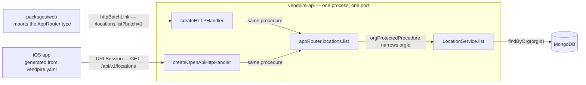
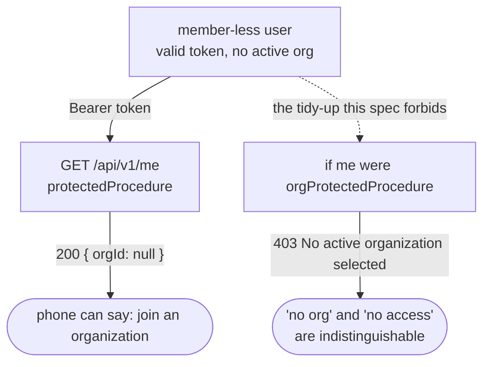
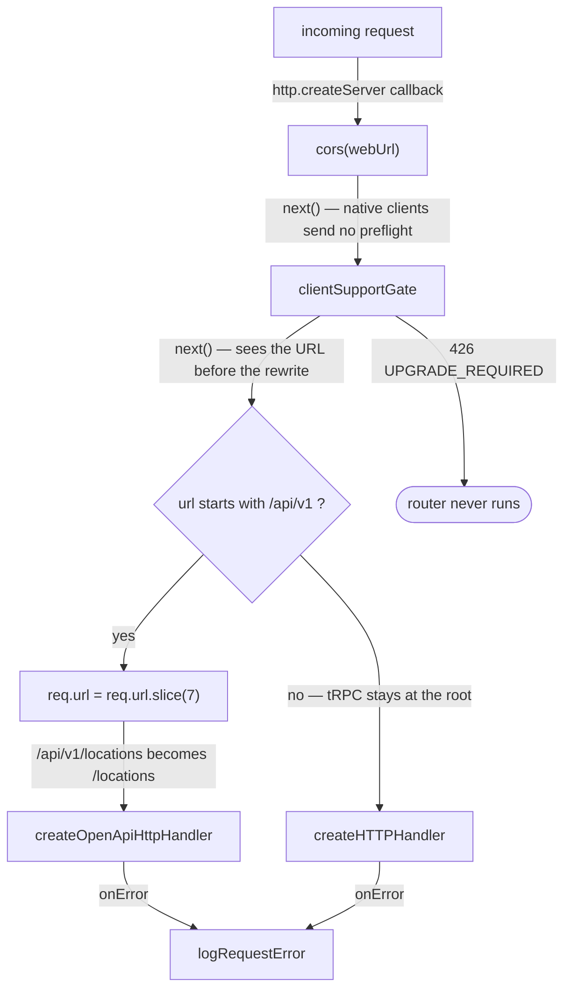
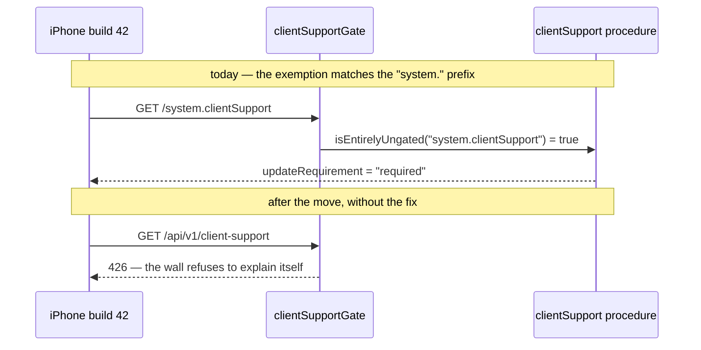
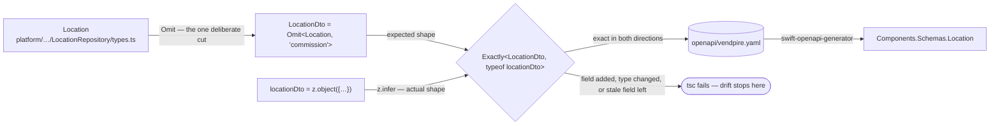
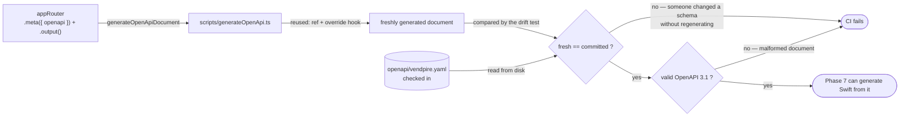

# REST/OpenAPI surface (`/api/v1`)

> **Status:** design of record as of 2026-10-21. Adds a second *transport* over
> the existing tRPC router — not a second API. One server, one port, one set of
> services. Supersedes the endpoint list on the Phase 6 shuffleboard card where
> the two disagree; disagreements are called out inline.

## Goal

**Give the iOS app a typed client against the same procedures the web app
already calls.**

tRPC's entire value is that the client imports the server's TypeScript types —
`packages/web` imports the `AppRouter` *type* only and gets end-to-end inference
with no codegen. Swift cannot import TypeScript types, so from Swift tRPC
degrades to a non-standard wire protocol (`{"result":{"data":…}}` envelopes
inside an array, comma-joined procedure names in the path for batching, input as
a URL-encoded JSON blob keyed by batch index) that would be hand-coded with no
type safety, against a format tRPC treats as an internal detail.

OpenAPI gives Swift the deal TypeScript already has: `swift-openapi-generator`
reads a committed spec and emits typed structs and client methods at build time.
One source of truth — the router — producing compile-time safety on both ends.

### This is one backend, not two

`trpc-to-openapi` derives the REST routes **from the existing `appRouter`**.
`GET /api/v1/locations` and `locations.list` are the same procedure, the same
`LocationService`, the same `orgProtectedProcedure`. There is no second
implementation to keep in sync. The README already frames it this way: *"Two
surfaces share one backend."*



### Why now, despite the card's precondition

The card says *"don't start until real visits have gone through Phase 5."* That
precondition is **not met** — visits have been entered on web, but no real route
data exists yet. We proceed anyway, deliberately:

1. **It is partly circular.** What makes real route days practical is the phone,
   and the phone is blocked on this. Waiting for real use to validate the API
   when the API is what enables the real use stalls indefinitely.
2. **Churn is acceptable while the only users are us.** Spec drift is designed
   to surface as a TypeScript error, not a silent wrong number.

A read-only split (the six GETs now, the two POSTs after real use) was
considered and rejected: the full ten-endpoint surface lands in one go.

## The ten endpoints

| REST | procedure | auth tier | `protect` |
|---|---|---|---|
| `GET /api/v1/client-support` | `system.clientSupport` | **public** | `false` |
| `GET /api/v1/me` | `auth.me` | **user** | `true` |
| `GET /api/v1/locations` | `locations.list` | org | `true` |
| `GET /api/v1/machines` | `machines.list` | org | `true` |
| `GET /api/v1/products` | `products.list` | org | `true` |
| `GET /api/v1/packs` | `packs.list` | org | `true` |
| `GET /api/v1/planograms/current` | `planograms.listCurrentByOrg` | org | `true` |
| `GET /api/v1/visits/latest` | `visits.listLatestByOrg` | org | `true` |
| `POST /api/v1/visits` | `visits.create` | org | `true` |
| `POST /api/v1/purchases` | `purchases.create` | org | `true` |

**Three auth tiers, not two.** `protect: true` cannot be blanket-applied.

- `client-support` is `publicProcedure` and must stay so — a client old enough
  to be walled is likely also holding an expired session, and a wall that needs
  a valid token to appear is a wall that doesn't appear.
- **`auth.me` is `protectedProcedure`, NOT `orgProtectedProcedure`, and must
  never be "tidied up" into one.** It returns `orgId: null` for a member-less
  user, which is the only way such a user discovers *why* they are stuck. Under
  an org gate it returns 403 with no way to tell "no org" from "no access" —
  the same pending-session trap that already bit the web app. A comment saying
  so goes on the procedure, not only in this document.



Only three of the ten take input at all: `visits.create`, `purchases.create`,
and `system.clientSupport`. The rest take none.

### Deliberately not on the surface

- **`barcodes.resolve`** — a 5-arm union. The phone resolves scans locally
  against its stored products and packs using the ported `normalizeGtin`, which
  is better offline behavior anyway. Only a code absent from the store needs the
  server, and that path hits the external catalog so it requires network
  regardless.
- **`commission` on the Location output** — a 3-arm `z.discriminatedUnion`
  (`LocationCommission`, the *only* union in the entire entity layer), cut from
  v1 because the phone has no use for it. See "the DTO decision" below.
- **No P&L endpoint.** The cost-basis as-of-interval fix therefore does not bake
  into this contract and does not need to be sequenced before this phase.

## Dependency state — settled empirically

This was the one finding that could have invalidated the approach. It does not,
but it reshapes the plan.

`trpc-to-openapi` splits at a major version, and the split is about zod:

| version | peer `zod` | peer `zod-openapi` | imports |
|---|---|---|---|
| 2.4.0 (last 2.x) | `^3.23.8` | `4.2.4` exact | `from 'zod'` — classic v3 |
| **3.3.3 (latest)** | `^3.25.0 \|\| ^4.0.0` | `^5.4.4` | `from 'zod/v4'` |

Both accept `@trpc/server ^11.1.0`.

**Nothing in the repo depends on zod 3.** Three `package.json` files say
`"zod": "^3.22.4"` — written at scaffold time, never revisited. No third-party
package in the tree declares a zod dependency or peer at all; the only zod line
in `bun.lock` is ours. `^3.22.4` already resolves to **3.25.76**, which
satisfies `zod-openapi@5`'s peer range today. There is no peer violation to fix.

The fact that reframes the choice: **zod 3.25.x and zod 4.x ship the same v4
code**, differing only in which import path it sits behind.

| package | bare `zod` | subpath |
|---|---|---|
| `zod@3.25.76` (current) | v3 API | `zod/v4` → v4 API |
| `zod@4.6.7` (target) | **v4 API** | `zod/v3` → v3 API |

So "import from `zod/v4`" and "bump to zod 4" reach the same destination, and
the version bump is the **smaller diff** — every `import { z } from "zod"` line
stays exactly as written.

**What this means practically: there is no per-file schema migration.** Bumping
the package version moves all 28 files to the v4 API at once, which is exactly
what is wanted — because v3 and v4 schemas cannot nest (below), a partial
migration would be the broken state. The only hand edits are whatever typecheck
surfaces, plus the five `z.url()` cleanups.

### Verified facts behind this decision

- **Mixed dialects fail loudly, not silently.** One classic-v3 schema on an
  exposed procedure throws at generation time:
  `[query.system.clientSupport] - Input parser expects a Zod validator`.
- **v3 and v4 schemas cannot nest in either direction** — `TS2740` at compile
  time and a runtime throw (`keyValidator._parse is not a function`). The
  migration boundary is a hard cut-line, not a gradient.
- **The migration surface is tiny.** The whole zod API surface across all 28
  importing files is 17 distinct calls. `invalid_type_error` / `required_error` /
  `errorMap` — the single biggest v4 breaking change — has **zero** occurrences.
  Apparent hits on `.record()` and `.strict()` are false positives: a repository
  method (`this.events.record(...)`) and a comment in `purchases.ts:52`.
- **The codebase's real schemas run clean under zod 4.6.7** with import lines
  untouched: `commissionInput`'s discriminated union with a `.default()` inside
  an arm, nested `.nullable().default(null)`, `z.coerce.number()` turning `"43"`
  into `43`, `objectId()`'s custom regex message, and unknown-key stripping. All
  identical; typecheck clean.

**Residual risk:** the schema *patterns* were verified, not all 28 files
individually. A `.default()` input/output type shift could surface through
`parseConfig`'s generics or tRPC's inferred input types. Typecheck catches it;
the fix is local.

## Design

### 1. Sequencing — three commits

1. **`chore: bump zod 3.25 → 4.6.7`** — three `package.json` files, zero import
   changes, plus the five `z.string().url()` → `z.url()` cleanups
   (`products.ts`, `serverConfig.ts`, `mobileConfig.ts`, `analyticsConfig.ts`,
   `tasksConfig.ts`; the last keeps its custom message). Full suite green before
   moving on, so a zod-4 behavior change bisects to a small diff rather than a
   40-file feature.
2. **`chore: pin tRPC and add the OpenAPI generator`** —
   `@trpc/server` and `@trpc/client` to exactly `11.19.0` (dropping the `^`, so
   the generator's peer surface cannot drift underneath us), and add
   `trpc-to-openapi@3.3.3` + `zod-openapi@5.4.6` to `packages/api`.
   `zod-openapi` is a peer of `trpc-to-openapi`; declare it explicitly in
   `packages/api/package.json` regardless of whether the installer hoists it,
   since the generator script imports from it directly.
3. **`feat(api): /api/v1 REST surface`** — everything below.

### 2. Mounting — one server, two handlers

`createHTTPServer` is one line in the tRPC standalone adapter:

```js
function createHTTPServer(opts) {
  return http.createServer(createHTTPHandler(opts));
}
```

Its callback assumes every request is a tRPC request; the only extension point
is the `middleware` slot, where `cors` and `clientSupportGate` already live.
`index.ts` therefore inlines that one line so the callback can branch. **This
adds no second server, port, or process.**



The gate running **before** the rewrite is load-bearing: it is why the exemption
rule below matches `/api/v1/client-support`, the path a real client sends. That
ordering gets a test rather than relying on reading comprehension.

`GET /system.version` stays where it is, so the e2e health check and
`global-setup.ts` need no changes.

**The `onError` logger moves out of the adapter call** into a named
`logRequestError` shared by both handlers. Today it is wired to `createHTTPServer`
(`index.ts:42-52`) and is the single place request errors are logged, with the
INTERNAL_SERVER_ERROR-vs-4xx split. A separately-mounted handler does not
inherit it, so every REST error would otherwise go unlogged.

The rejected alternative — routing inside the `middleware` slot — works and is a
smaller diff, but makes a middleware do something its name does not say, and
requires casting through `never` at the boundary because `MiddlewareRequest` is
deliberately structural rather than `node:http`'s type (`middleware/types.ts:7`
explains why: the `cors` and Bun typings disagree about `IncomingMessage`).

### 3. The gate exemption — a silent failure this phase must not ship

`MobileClientSupportServiceImpl.ts:16` exempts requests on
`UNGATED_PREFIX = "system."` — a tRPC *procedure-name* convention. The moment
`client-support` moves to `/api/v1/client-support`, that match fails and **the
426 gate refuses the one endpoint that explains the wall.** Exactly the failure
the forced-update card warns about, and it fails silently.



The rule stays in the service. The card's invariant is that one implementation
answers both the launch check and the gate so the two cannot disagree; splitting
the exemption across two files breaks precisely that. It grows a second
convention, with a comment recording why there are two:

```ts
const UNGATED_TRPC_PREFIX = "system.";   // batched: "system.version,system.clientSupport"
const UNGATED_REST_PATHS = new Set(["/api/v1/client-support"]);
```

The two existing pass-through rules remain load-bearing and unchanged: a missing
`X-Vendpire-Client` header must pass (the web app sends none, and the e2e health
check hits `/system.version` bare), and `client-support` is never gated.

**Test:** a too-old build gets `426` on `/api/v1/visits` and `200` on
`/api/v1/client-support`.

### 4. Output schemas — `packages/api/src/schemas/`

**The main cost of this phase.** No procedure in the codebase declares
`.output()` or `.meta()` today; every response type is inferred from the service
return value. tRPC can infer it, a spec file cannot — it must be written down.

One file per entity, nine schemas covering all ten endpoints (`visits/latest`
and `POST /visits` share `Visit`). Each carries `.meta({ id: "Location" })` so it
lands in `components/schemas` as a named, `$ref`'d type.

**Entity types live in `packages/platform`, not `packages/domain`** — at
`data-access/repositories/*/types.ts`. They are exported from the *contract*
barrel (`platform/src/index.ts:19`), not `/server`, so annotating against them
does not drag tsyringe-decorated classes into the web compile. The TS1206 trap
recorded on the forced-update card does not bite here.

#### The DTO decision

The Location output omits `commission`, so the schema **cannot** satisfy
`z.ZodType<Location>` and will not compile. The risk is that someone weakens the
annotation to make the build pass, discarding the drift detection that is the
entire point. Instead, declare the omission:

```ts
type LocationDto = Omit<Location, "commission">;
```

so removing a field stays an explicit decision rather than an accident.

#### Bidirectional exactness, not a plain annotation

`z.ZodType<Dto>` catches a field **added** to the entity and a field whose
**type changed** — both verified as compile errors. But a **stale extra field
left in the schema typechecks clean** (verified), because extra properties are
structurally assignable through a generic. That direction is the damaging one:
`.output()` strips the field at runtime while the spec still advertises it as
required, and Swift gets a required property that never arrives.

An `Exactly<>` helper closes both directions (verified working):

```ts
type Equal<A, B> = (<G>() => G extends A ? 1 : 2) extends <G>() => G extends B ? 1 : 2 ? true : false;
type Exactly<Dto, S extends z.ZodType> = Equal<z.infer<S>, Dto> extends true ? S : never;
```

Its failure message (`not assignable to type 'never'`) is poor; a short comment
at the helper explains what the error means when it fires.



**Gotcha to keep in mind:** `.output()` strips unknown keys at runtime. Outputs
are exact DTOs from the `toX()` mappers so this should be a no-op — but it is
the first thing to check if a field goes missing.

### 5. Generation — `scripts/generateOpenApi.ts` → `openapi/vendpire.yaml`

Committed, so the Swift build never needs a running server. A test asserts the
committed document matches a fresh generation, so an un-regenerated schema
change fails CI.



Three settings that matter more than they look:

- **OpenAPI 3.1, and there is no choice.** Passing `openApiVersion: "3.0.3"`
  prints `Invalid target: openapi-3.0` and **still emits 3.1 syntax** — a
  document labelled 3.0.3 containing constructs invalid in 3.0. Silently wrong.
  A comment at the call site prevents someone "fixing" the version string later.
- **`reused: "ref"`.** The default inlines reused schemas, which would give
  Phase 7 a pile of duplicate anonymous structs instead of one
  `Components.Schemas.Location`. With it, responses emit
  `{"$ref": "#/components/schemas/Location"}`.
- **An `override` hook** doing two things (both verified):
  1. Collapse `anyOf: [{type: T}, {type: "null"}]` into the canonical 3.1
     `type: [T, "null"]`, which maps to a Swift optional rather than an `anyOf`
     wrapper. This matters because the entities are full of nullable fields.
  2. `if (ctx.io === "output") delete ctx.jsonSchema.additionalProperties` — so a
     field added to the server later cannot break an older phone build.

**On `additionalProperties`:** only *responses* carry it. Request bodies never
do, because zod's `$strip` means unknown input keys are dropped rather than
rejected, which zod-openapi correctly renders as no constraint. This already
matches the router's documented behavior (`purchases.ts:52`: *"plain object
strips and `.strict()` would reject with a 400"*). So the override only ever
touches responses; there is no input strictness to preserve.

Stripping it is a judgement call, not a proven necessity: it is certain that
`additionalProperties: false` lands in the spec otherwise and that
`swift-openapi-generator` keys off it, but **not verified** that it causes a hard
decode failure on an unknown field — that is Phase 7 and untestable here.
Stripping costs one line and makes the question moot. It also matches the
fail-open posture the forced-update work is built on, where an unrecognized
`updateRequirement` decodes as `.none` precisely so a newer server cannot wall
people on a string an old build cannot parse.

**Plus a test validating the generated document against the OpenAPI 3.1
meta-schema.** Cheap, and the only thing standing between us and discovering a
malformed spec in Phase 7 when the Swift build fails.

### 6. GET input coercion — confirmed working

`system.clientSupport` takes `build: z.number().int()`. As a GET its input
arrives in the query string, where `build` is the string `"43"`. Verified:
`trpc-to-openapi` coerces GET inputs from the zod schema (`coerceSchema` sets
`_def.coerce = true` on coercible shape members), so `"43"` parses as `43`.

Note it **mutates the schema object in place**, so the copy the web path uses
becomes coercive too. Harmless — coercion only loosens — but worth a comment.

### 7. e2e

`packages/e2e/fixtures.ts:94` hardcodes the api's env block with no override
seam, so no spec can boot an api with a configured floor. Parameterize
`apiStack` as a Playwright fixture option following the `workerStack` pattern
(~30 lines).

That unblocks and **closes both open `[P6]` subtasks on the forced-update
card** — `client-support` reachable with no auth, and a too-old build getting
the real status off the wire. Worth having for one reason above all: it is the
only check that catches the endpoint being mounted behind auth. It is the one
`publicProcedure` on an otherwise all-`orgProtectedProcedure` surface, and if it
ends up protected, a blocked client with an expired session never sees the wall,
silently. No service-level unit test can catch that.

Plus a new REST spec covering the ten endpoints and an idempotent re-POST of a
visit on the same `clientRequestId`.

**What e2e can never cover:** Playwright drives Chromium. The gate, the wall and
the middleware are Swift — XCTest plus the manual staging check. e2e covers the
dial, not the thing that fails to turn.

## Known limitations accepted in v1

- **`visits.create` drops its envelope.** The service returns `VisitCreation`
  (`visit`, `isReplay`, `isOutOfOrder`, `anomalies`, `notices`), but the router
  already returns `creation.visit` alone, with a comment at `visits.ts:170`
  anticipating this phase. That keeps two more unions off the surface
  (`VisitAnomaly`, `VisitNotice`), at the cost that **the phone never learns a
  visit stored with anomalies** — over-par and over-removed are logged
  server-side only. Deliberate for v1; revisit when the phone has UI for it.
- **`commission` is invisible to the phone**, per the card.

## The risk this creates

**The spec is not validated against `swift-openapi-generator` in this phase.**
That is Phase 7 and cannot be run here. The `reused: "ref"`, nullable-collapsing
and meta-schema work is what reduces the risk, but it remains residual: if the
Swift generator objects to something in the document, we find out in Phase 7,
not now.

The mitigating factor is that nothing about the generated document is exotic —
named component schemas, `$ref`s, type-array nullables and bearer security are
the most conventional shapes OpenAPI 3.1 has.

## Verification

- `bun run typecheck` and `bun run test` green after the zod bump alone, before
  any REST work lands.
- `bun run typecheck`, `bun run test`, `bun run lint` green at the end.
- The drift test: committed `openapi/vendpire.yaml` matches a fresh generation.
- The meta-schema test: the generated document is valid OpenAPI 3.1.
- An `Exactly<>` violation is a compile error — confirmed for a field added to
  the entity, a field whose type changed, and a stale field left in the schema.
- e2e: ten endpoints respond; `client-support` reachable unauthenticated; a
  too-old build gets `426` on `/api/v1/visits` and `200` on
  `/api/v1/client-support`; a repeated `POST /api/v1/visits` with the same
  `clientRequestId` returns the first visit rather than creating a second.
