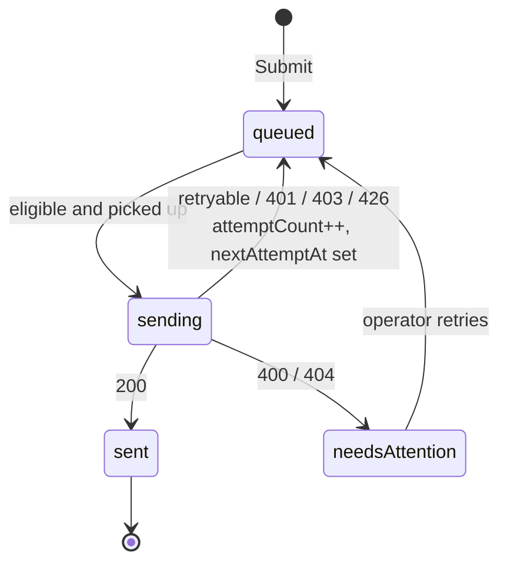
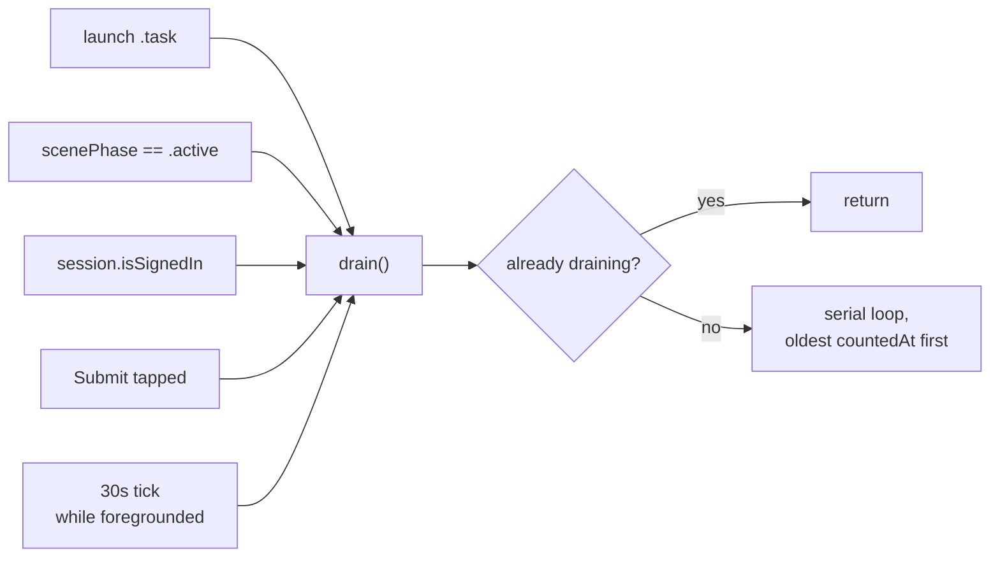
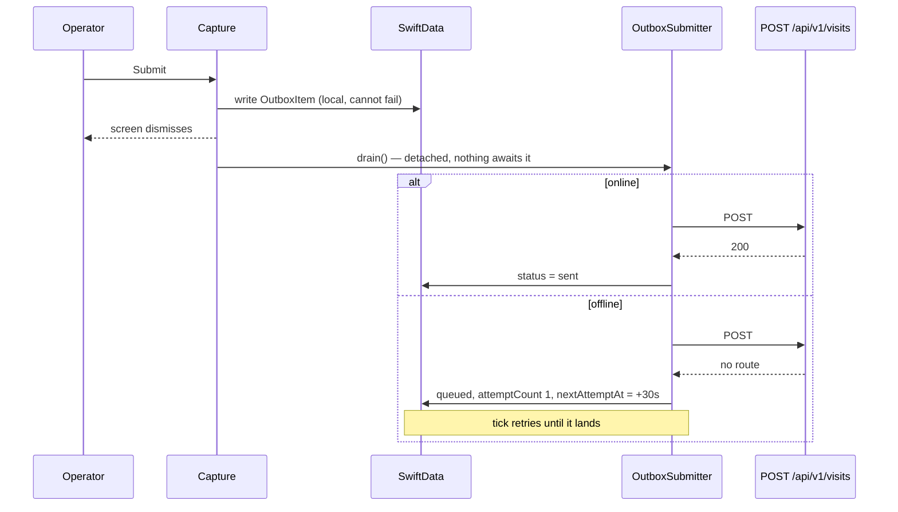

# The visit outbox

First of two specs for Phase 8, which is being built outbox-first. The second covers capture.

The outbox takes a payload and gets it to the server eventually, through a basement, an app
restart, an expired token and a version floor. It does not know what a visit is.

## Why first

It needs nothing from capture, so it can be built and proven against a stubbed API with
synthetic payloads and no UI at all. Capture's **Submit** then enqueues into a pipe that
already works, rather than posting directly and being retrofitted later — and retrofitting the
submit path is exactly where "never drop a draft" gets lost.

It also sidesteps both of Phase 8's open questions, which are capture-side: whether the draft
is one model or two, and where **Start visit** lives.

**Consequence: the two field tests move to the capture spec.** The offline drill and the
idempotency proof both need capture to produce a real visit. This spec proves classification,
ordering, backoff and persistence; it cannot prove the drill.

## The correction this spec carries

The Phase 8 card said payloads must be built at save time and stored as frozen `Data`, because
re-encoding under a newer generated type would silently break old drafts. **That was wrong for
this codebase.**

`Remote+Generated.swift` is "the only file in the app that knows the generated types exist, so
a spec change becomes a compile error here." `Remote*` and `Stored*` are hand-written. A
renamed field breaks the build in one known file rather than silently re-encoding to a default
— a compile-time guard, which beats the runtime 400 frozen bytes would produce.

Frozen bytes were also worse in two cases:

- **Unfixable drafts.** A new required field 400s every queued row forever and the operator
  re-types a day of counts. A struct can be migrated in code.
- **Semantic change.** If a field's meaning changes without its shape changing, frozen bytes
  are silently reinterpreted by the server with no error anywhere.

`schemaVersion` is retained, for migration rather than for freezing.

## Shape

Mirrors `MirrorRefresher`: an `@Observable` service owning a `ModelContext`, taking
`VendpireAPI` as a protocol, with a coalescing guard. Named `OutboxSubmitter` for the
agent-noun symmetry — `visit-sync.md` calls it `OutboxDrain` and should be updated.

```
Services/Outbox/OutboxSubmitter.swift     the drain loop — the only async part
Services/Outbox/SubmitOutcome.swift       classification + backoff, both pure
Store/Model/StoredEntities.swift          OutboxItem
Store/Model/StoredEntityQueries.swift     the eligibility predicate
```

## The model

```swift
@Model final class OutboxItem {
    #Unique<OutboxItem>([\.id])

    /// == clientRequestId, minted at Start visit. An edited draft keeps it, so
    /// a twice-edited offline draft cannot double-post.
    var id: String = ""
    /// "visit" | "purchase". Raw String for the same reason Machine.kind is:
    /// an unfamiliar value from a newer build must still load.
    var kind: String = "visit"
    /// Drain order. When the observation was made, not when the row was written.
    var countedAt: Date = Date.distantPast
    var payload: Data = Data()
    var schemaVersion: Int = 1
    /// queued | sending | sent | needsAttention
    var status: String = "queued"
    var attemptCount: Int = 0
    var nextAttemptAt: Date?
    /// The server's words, shown to the operator verbatim.
    var lastMessage: String?
}
```

Generic over `kind` from the start even though Phase 8 only ever enqueues visits. Phase 9 adds
a producer rather than a schema migration — and this is the worst table in the app to migrate,
because by then it may hold unsent field data.

`kind` and `status` are raw `String`s, not enums. Same rule as the read path, and it sidesteps
the open "closed enums strand every phone" card.

## Classification — pure, no HTTP

`POST /visits` documents 200, 400, 401, 403, 426 and 500, so the generated client yields a case
for each and classification is a `switch` over the response enum. No error unwrapping, and no
reason to leave the generated client for the write path — `try response.ok` in
`VendpireAPIClient` is a read-path convenience, not a constraint.

```swift
enum SubmitOutcome: Equatable {
    case accepted(visitId: String)
    case retryable
    case unauthorized
    case noOrganization
    case blockedByUpdateFloor
    case permanent(message: String)
}

/// Exponential, capped at one hour. Jitter is a parameter rather than a call to
/// random() so the curve and the cap are deterministically testable.
func backoffDelay(attemptCount: Int, jitter: Double) -> TimeInterval
```

| Response | Outcome | Treatment |
|---|---|---|
| 200 | `.accepted` | Success, including an idempotent repeat returning the original visit |
| Network / timeout / 5xx / 429 | `.retryable` | Backoff + jitter, cap ~1h, infinite |
| 401 | `.unauthorized` | One retry — `AuthTokenMiddleware` fetches a fresh token per request — then back off. Never permanent |
| 403 | `.noOrganization` | Retryable; surface "you're not in an organization" |
| 426 | `.blockedByUpdateFloor` | Retryable, never `needsAttention`. The client keeps every draft and drains after updating |
| 400 / 404 | `.permanent` | `needsAttention`, listed with the server's message |

**`.accepted` is the only exit from the machine.** Nothing else deletes a row. That single rule
is what keeps a day's counts from vanishing.



## The drain

Serial, oldest `countedAt` first, stopping at the first retryable failure — sending N+1 before
N trips the server's out-of-order path for nothing.

```swift
func drain() async {
    guard state != .draining else { return }
    state = .draining
    defer { state = .idle }

    guard await updateGateIsOpen() else { return }

    while let item = nextEligible() {
        switch await submit(item) {
        case .accepted(let visitId): markSent(item, visitId)
        case .permanent(let message): markNeedsAttention(item, message)
        default: scheduleBackoff(item); return
        }
    }
}
```

`nextEligible()` **re-queries each iteration** rather than snapshotting. Two reasons: a visit
submitted while a drain is already running is picked up in the same pass instead of waiting for
the next tick behind a coalescing guard that rejected its `drain()` call, and an item whose
backoff just expired becomes eligible without a second pass. The queue is a handful of local
rows, so the cost is nothing.

```swift
extension OutboxItem {
    /// Oldest countedAt first; queued only; backoff respected.
    static func eligible(asOf now: Date) -> Predicate<OutboxItem>
    static let oldestFirst = [SortDescriptor(\OutboxItem.countedAt, order: .forward)]
}
```

The update gate is checked **before** the loop, not after a submit fails. A too-old client
writing under an incompatible contract is the thing the version floor exists to prevent. See
`docs/diagrams/forced-update.md`.

## What wakes it

The same four triggers as `MirrorRefresher`, plus one the mirror does not need.



The tick exists because backoff needs a retry that lifecycle events will not provide. The real
case: submit in a basement, walk upstairs, never background the app. Without a tick those
counts sit unsent with a working connection and nothing on screen to explain it.

A request attempted with no route fails fast and cheap, so polling costs little.
`NWPathMonitor` would be more precise and is an easy later addition; it is not needed to make
the behaviour correct.

## What the operator sees

Nothing, which is the point.



The screen dismisses on the local write in both branches. No spinner, no error, no retry
button. A failed network call at submit time is not an event the operator should have to
respond to — when there is signal the outbox is indistinguishable from posting directly, and
when there is not, the only difference is how long a sync indicator shows pending.

A drain processes the whole queue, so a fresh submit goes **last** if earlier visits are stuck.
Deliberate: sold units are derived from consecutive visits, and sending them out of order makes
the server reconcile for no reason.

## Tests

`SubmitOutcomeTests` — pure, instant:

- Every documented status maps to its outcome; an undocumented status is `.retryable`
- 426 is `.retryable`, never `.permanent` — the regression test for the version floor
- `backoffDelay` is monotonic in `attemptCount` and never exceeds one hour
- Jitter at its extremes stays within the cap

`OutboxSubmitterTests` — real service, stub API, in-memory container:

- Two queued rows drain in `countedAt` order, not insertion order
- A retryable failure on the first row stops the pass; the second is untouched
- A 500 leaves the row `queued` with `attemptCount` bumped and `nextAttemptAt` in the future
- A 400 lands in `needsAttention` carrying the server's message
- An item with `nextAttemptAt` in the future is skipped
- A row enqueued mid-drain is picked up in the same pass
- A repeated `clientRequestId` does not create a second row
- **No path except `.accepted` deletes a row** — assert the count after every failure mode

## Out of scope

The **outbox review screen** (pending + `needsAttention` with the server's message, reached
from `AccountView`) moves to the capture spec. Nothing here can produce an item, so it could
only be tested against hand-seeded rows and `needsAttention` would have no real content. It
carries over as an explicit subtask rather than disappearing.

Also out: capture itself · the draft model and whether it is one model or two · purchase
submission (Phase 9 adds a producer, not a schema change) · `NWPathMonitor` · the offline drill
and the idempotency proof, both of which need capture.
